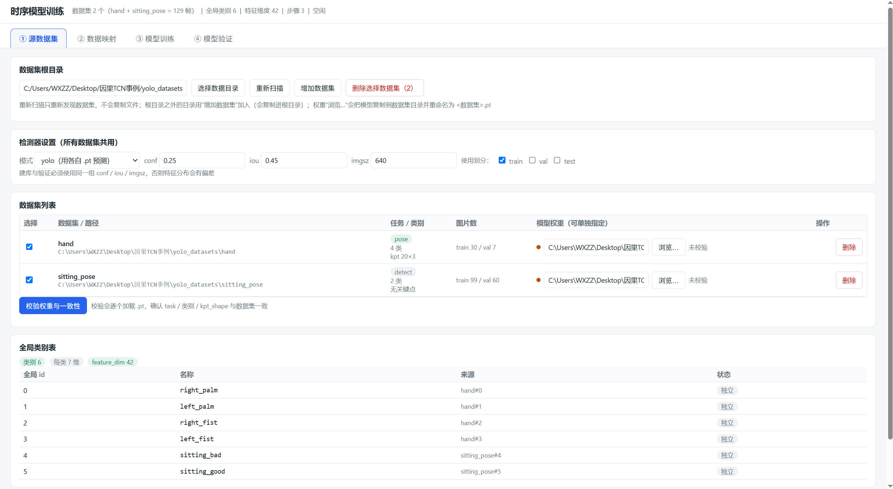
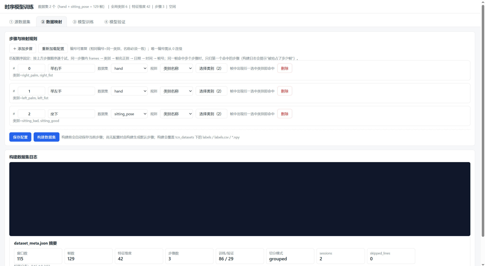
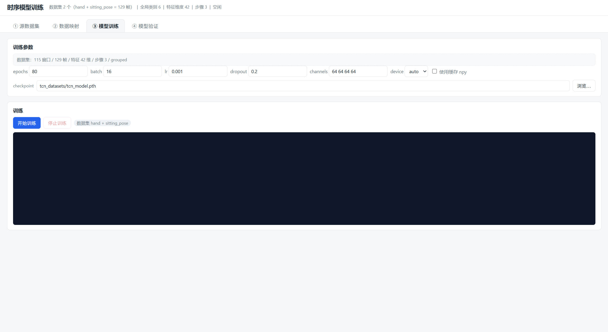
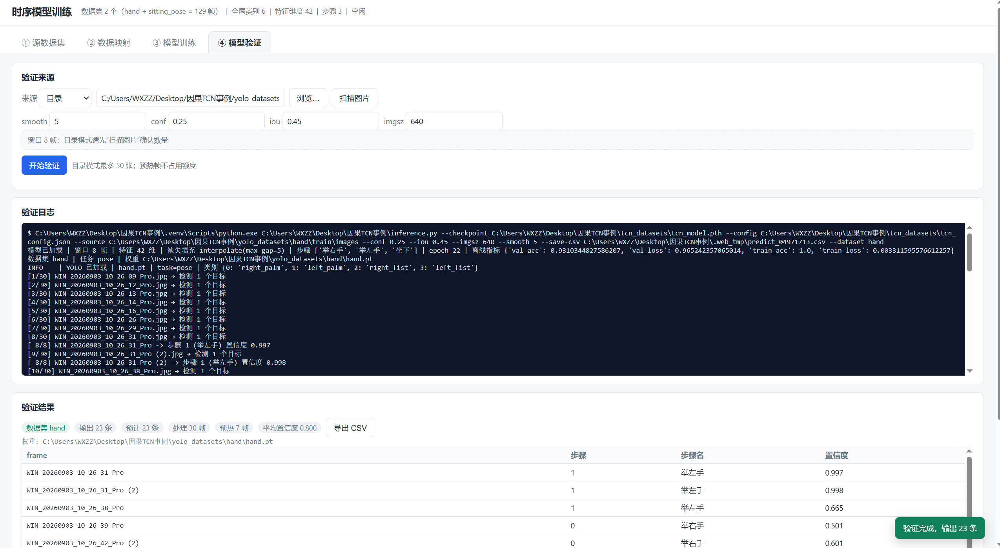

# 因果 TCN 工序步骤识别（YOLO 标注数据集 → 因果时序卷积网络模型）

**YOLO 负责"这一帧看到了什么"，TCN 负责"这一段时间处于第几步"。**

流程：`yolo_datasets` → `build_dataset.py` → `tcn_datasets` → `train.py` → `tcn_datasets/tcn_model.pth` → `inference.py`

## 目录结构

```
因果TCN事例/
├─ yolo_datasets/                 # ★ 多 YOLO 数据集根目录（每个子目录 = 一个数据集）
│  ├─ hand/                       # 数据集名 = 目录名
│  │  ├─ hand.pt                  # 权重约定：<目录名>.pt
│  │  ├─ dataset.yaml             # task / nc / names / kpt_shape
│  │  ├─ classes.txt              # 对象类别名（一行一个）
│  │  └─ train/{images,labels}/   # val/ test/ 可选
│  └─ sitting_pose/
│     ├─ sitting_pose.pt
│     ├─ dataset.yaml
│     └─ train/{images,labels}/
├─ tcn_datasets/                  # 转换后的因果 TCN 数据集（脚本自动生成）
│  ├─ tcn_config.json             # ★ 步骤定义 + 窗口参数（可手工编辑）
│  ├─ labels/                     # 平铺的逐帧 txt：<数据集>__<帧名>.txt
│  ├─ labels.csv                  # frame,label,step_name
│  ├─ X_train.npy / y_train.npy / X_val.npy / y_val.npy
│  ├─ dataset_meta.json           # 数据统计（窗口数、标签分布、特征维度…）
│  └─ tcn_model.pth               # 训练输出
├─ build_dataset.py               # yolo_datasets/* → tcn_datasets
├─ train.py                       # 训练，输出 tcn_datasets/tcn_model.pth
├─ inference.py                   # 推理（标注回放 / 图像 + YOLO / npy 批量）
├─ detectors.py                   # YOLO 推理 + 类别重映射（建库与推理共用）
├─ config.py                      # 路径与 DataConfig / TCNConfig / TrainConfig
├─ data_processor.py              # 解析 → 聚合 → 插值 → 特征 → 滑窗
├─ model.py                       # CausalConv1d / TemporalBlock / CausalTCNClassifier
└─ tests/                         # 19 个单元测试
```

## 功能截图





## 快速开始

```powershell
cd C:\Users\WXZZ\Desktop\因果TCN事例
$env:PYTHONUTF8 = '1'

# ① 转换数据集：自动发现 yolo_datasets 下所有子目录，合并成一套特征
#    每个数据集用 yolo_datasets\<数据集>\<数据集>.pt 的【预测结果】作为特征来源
python build_dataset.py

#    若想直接用人工标注作为特征来源
python build_dataset.py --detector labels

#    需要更多划分时显式指定（会按帧名去重）
python build_dataset.py --split train val

# ② 训练（默认读取 tcn_datasets，输出 tcn_datasets/tcn_model.pth）
python train.py --epochs 60 --batch-size 8 --channels 32 32 32

# ③ 推理：回放标注
python inference.py --smooth 1

# ③ 推理：图像目录（按路径自动判断属于哪个数据集）
python inference.py --source yolo_datasets\hand\train\images
python inference.py --source yolo_datasets\sitting_pose\train\images

# ③ 推理：单张图片（用同目录前几张图预热窗口）
python inference.py --source yolo_datasets\hand\train\images\WIN_20260903_10_26_45_Pro.jpg

# ④ 单元测试
python -m pytest tests -q
```

## Web 界面（时序模型训练）

四步向导：**源数据集 → 数据映射 → 模型训练 → 模型验证**。

```powershell
$env:PYTHONUTF8 = '1'
pip install flask          # 首次
python web_server.py --port 5000
# 浏览器打开 http://127.0.0.1:5000
```

- 只监听 `127.0.0.1`，不对外网；`debug=False`（避免子进程重复启动）
- 长任务（构建/训练/验证）走 **SSE**：`POST /api/dataset/build` / `/api/train` / `/api/validate`
- 同一时刻只允许一个任务；`POST /api/train/stop` 终止子进程
- 任务运行中禁止保存配置 / 增删数据集 / 导入权重（返回 `E_TASK_BUSY`），避免产物与配置版本错位
- 页面刷新会从 `/api/task/status` 与 `/api/dataset/meta` 恢复任务状态与数据集摘要
- 权重、checkpoint 可以选任意目录（移植到其它项目时数据集与模型常不在一处）
- 前端为原生 HTML/CSS/ES Module，代码在 `web/`，无构建步骤

Tab1「源数据集」的目录操作：

| 按钮 | 作用 |
|---|---|
| `选择数据目录` | 只弹出目录选择框并回填根目录，**不触发扫描** |
| `重新扫描` | 按根目录发现其下所有子目录（**不会复制文件**，遵守已删除记录；根目录会被记住） |
| `增加数据集` | 选择单个数据集目录加入列表；目录在根目录之外时会复制进根目录（原目录保留） |
| `删除选择数据集` / 每行 `删除` | 只从列表移除（**不删除磁盘文件**），并写入排除记录；选“删除数据集与模型”才会删磁盘 |

增减记录与根目录保存在 `tcn_datasets/web_datasets.json`，建库时分别转成
`build_dataset.py --dataset-dir` / `--exclude-dataset`，保证列表与产物一致；
删除后想恢复，用「增加数据集」重新选中该目录即可。

主要接口：`/api/dataset/scan`、`/api/dataset/meta`、`/api/datasets/validate`、`/api/datasets/add`、`/api/datasets/remove`、`/api/images/scan`、`/api/config`、`/api/dataset/build`、`/api/train`、`/api/validate`、`/api/task/status`、`/api/fs/pick`。

## 多数据集约定

| 规则 | 说明 |
|---|---|
| 数据集发现 | `yolo_datasets/` 下每个子目录是一个数据集，名字即数据集名 |
| 权重约定 | 默认 `<数据集>/<数据集>.pt`（**仅推荐值**）；可用 `--weights hand=D:/models/hand.pt` 或直接改配置里的 `weights` 指向任意目录/盘符 |
| 任务可混合 | `pose` / `detect` / `seg` / `obb` 可以混用，但所有 `pose` 的 `kpt_shape` 必须一致 |
| 类别合并 | 按**类别名**做并集：同名共用一个全局槽位，异名各占一个；可用 `class_aliases` 合并同义异名 |
| 特征维度 | `feature_dim = 全局类别数 × 7`（`cx/cy/w/h/mask/dx/dy`） |
| 帧名隔离 | 统一加 `<数据集>__` 前缀，`session_pattern=^.+?__` 保证滑窗不跨数据集 |
| 切分方式 | 先按时间段分组（数据集/视频段），**每组各自**按时间切训练/验证，避免某个大数据集独占验证集 |
| 手工增减 | 网页「增加数据集」→ `--dataset-dir`；网页删除 → `--exclude-dataset`；记录在 `tcn_datasets/web_datasets.json` |

> `dataset.yaml` 里的 `names` 支持行内写法（`names: ['a','b']` / `names: {0: a}`）和
> 块状写法（`names:` 下一行起逐行 `- a`），没有 `task:` 键时按 `detect` 处理。


## 关键概念：**对象类别 ≠ 工序步骤**

| | 来源 | 作用 | 是否出现在推理结果里 |
|---|---|---|---|
| **对象类别** | 各数据集的 `classes.txt` / `dataset.yaml`（`right_palm`、`sitting_bad` 等） | 决定特征槽位 `cx/cy/w/h/mask × N`（N = 全局类别数） | ❌ 不出现 |
| **工序步骤** | `tcn_datasets/tcn_config.json` 的 `steps` | 分类头的输出类别 | ✅ 就是它 |

两者数量互相独立：本例 6 个全局对象类别 → 42 维特征；4 个步骤 → 4 个输出。

> TCN 的特征里**不含关键点**（`pose` 的关键点只用于 `pose_center_mode=keypoints` 时计算中心点），
> 所以 `pose` 与 `detect` 对 TCN 的差别仅在于框的质量。

## 步骤配置：`tcn_datasets/tcn_config.json`

首次运行 `build_dataset.py` 会按**文件名时间戳的空隙**自动切分步骤（间隔 > 3 秒视为新步骤，
不足一个窗口的段会并入相邻段），并写成下面这样的文件。**请按真实工序改写。**

```json
{
  "version": 2,
  "source": {
    "yolo_root": "C:/Users/WXZZ/Desktop/因果TCN事例/yolo_datasets",
    "detector_defaults": {"type": "yolo"},
    "datasets": [
      {
        "name": "hand",
        "path": ".../yolo_datasets/hand",
        "weights": ".../yolo_datasets/hand/hand.pt",
        "task": "pose",
        "kpt_shape": [20, 3],
        "classes": ["right_palm", "left_palm", "right_fist", "left_fist"],
        "class_map": [0, 1, 2, 3]
      },
      {
        "name": "sitting_pose",
        "path": ".../yolo_datasets/sitting_pose",
        "weights": ".../yolo_datasets/sitting_pose/sitting_pose.pt",
        "task": "detect",
        "kpt_shape": null,
        "classes": ["sitting_bad", "sitting_good"],
        "class_map": [4, 5]
      }
    ]
  },
  "class_aliases": {},
  "object_classes": {
    "num_target_classes": 6,
    "target_names": ["right_palm", "left_palm", "right_fist", "left_fist",
                     "sitting_bad", "sitting_good"],
    "kpt_shape": [20, 3],
    "tasks": {"hand": "pose", "sitting_pose": "detect"}
  },
  "dataset": {
    "window_size": 8,
    "stride": 1,
    "label_mode": "last",
    "pose_center_mode": "bbox",
    "missing_strategy": "interpolate",
    "max_gap": 5,
    "include_size": true,
    "include_velocity": true,
    "session_pattern": "^.+?__",
    "val_ratio": 0.25,
    "gap": 0
  },
  "steps": [
    {"id": 0, "name": "hand-阶段1", "match": {"dataset": "hand",
      "datetime_from": "2026-09-03 10:26:09", "datetime_to": "2026-09-03 10:26:31"}},
    {"id": 1, "name": "sitting_pose-阶段1", "match": {"dataset": "sitting_pose",
      "pattern": "^sitting_pose__.*good"}}
  ],
  "unmatched": null
}
```

- `class_map[i]` = 该数据集第 `i` 个类别在**全局类别表**中的槽位；改类别名后重跑脚本会自动重排。
- `tcn_config.json` 的 `version` 不是 `2`（旧版单数据集结构）时会被**自动重建**，手工步骤会丢失，
  重建后请重新填写。想保留手工步骤就先备份该文件。

### 步骤匹配规则（`steps[i].match`，按列表顺序先匹配先得）

| 键 | 说明 |
|---|---|
| `dataset` | 限定只对某个数据集生效（**多数据集场景几乎必填**） |
| `frames` | 精确帧名列表（不含扩展名，写完整 `<数据集>__<帧名>` 更稳） |
| `pattern` | 对帧名做 `re.search` 的正则 |
| `datetime_from` / `datetime_to` | `YYYY-MM-DD HH:MM:SS`，基于文件名时间戳 |
| `time_from` / `time_to` | `HH:MM:SS`，只比较时刻 |
| `index_from` / `index_to` | 全局排序后的 1 基帧号（含两端） |

未命中任何规则且 `unmatched` 不是整数时，该帧不写入 `labels.csv`，相关窗口自动丢弃。

### 约束

- 步骤 `id` 必须**从 0 连续**（否则 `compute_class_weights` 会静默关闭类别加权）
- 模型是**单标签 softmax**，步骤必须互斥（并行工序需改多标签头）
- 每个步骤至少要有 `window_size` 帧，否则切不出窗口
- 步骤必须在**特征上可区分**（TCN 只看坐标/速度，看不到图像语义）

改完配置后重新运行：

```powershell
python build_dataset.py          # 保留你改过的 steps
python build_dataset.py --reset-config   # 按时间空隙重新生成（会覆盖手工步骤）
python build_dataset.py --config-only    # 只生成 labels.csv，不建 npy

# 手工增减数据集（与网页 Tab1 的“增加/删除”等价）
python build_dataset.py --dataset-dir D:\datasets\extra   # 额外加入一个数据集目录，可重复
python build_dataset.py --exclude-dataset yolo_datasets\hand  # 排除某个目录，可重复
```

## 训练

```powershell
python train.py
```

默认读取 `tcn_datasets/tcn_config.json` 里的窗口/步骤参数，并把产物写回 `tcn_datasets`：

| 产物 | 说明 |
|---|---|
| `tcn_datasets/tcn_model.pth` | 权重 + 结构配置 + 归一化统计 + 步骤名 |
| `tcn_datasets/dataset_meta.json` | `num_windows` / `label_distribution` / `feature_dim` 等 |

CLI 可覆盖配置（不传则用 JSON 里的值）：

| 参数 | 说明 |
|---|---|
| `--window` / `--stride` | 窗口长度 / 步长 |
| `--val-ratio` / `--gap` | 验证集比例 / 训练验证接缝隔离窗口数 |
| `--channels` | TCN 各层通道数，层数 L 决定感受野 `1+2(k-1)(2^L-1)` |
| `--from-npy` | 直接用已导出的 npy，跳过解析 |
| `--dataset-config` | 指定其他 `tcn_config.json` |

## 推理

```powershell
# 回放逐帧标注（默认 tcn_datasets/labels）
python inference.py --smooth 1

# 真实图像 + YOLO 逐帧检测：按 --source 路径自动判断属于哪个数据集并选权重
python inference.py --source yolo_datasets\hand\train\images
python inference.py --source yolo_datasets\sitting_pose\train\images

# 拷到别的目录时按目录名匹配（…\hand\train\images → hand）；仍无法判断再显式指定
python inference.py --source D:\temp\hand\train\images
python inference.py --source D:\temp\imgs --dataset sitting_pose

# 手动覆盖权重（默认用 <数据集>/<数据集>.pt）
python inference.py --source yolo_datasets\hand\train\images `
  --yolo-weights yolo_datasets\hand\hand.pt --conf 0.25 --iou 0.45 --imgsz 640

# 单张图片：用同目录前面的 7 张图预热窗口，只输出这张图的判定
python inference.py --source yolo_datasets\hand\train\images\WIN_20260903_10_26_45_Pro.jpg

# 批量评估已导出的窗口
python inference.py --npy tcn_datasets\X_val.npy

# 换用其它配置文件
python inference.py --config other\tcn_config.json
```

- `--source` 会自动识别：目录里是 `*.txt` → 标注回放；是图片目录 → 走检测器；是单张图片 → 预热后只输出该帧
- 标注回放优先读取 `--source` 同级的 `labels.csv`：**只回放参与训练的帧**，并按配置里的 `session_pattern` 分段，切换数据集/视频段时自动重置时间窗；找不到 CSV 才回退到目录内全部 `*.txt`（可用 `--label-csv` 显式指定）
- 数据集判定优先级：`--dataset` > `--source` 路径归属 > 路径中目录名与数据集名匹配（取最靠近图片的一层）> 唯一数据集兜底；都判断不出来会报错并列出可选名字
- 单张图片要求窗口前面至少有 `window_size-1` 张同目录图片，不足时按实际可用帧数降级（可能不输出结果）
- 数据集没有 `<数据集>.pt` 时，会尝试复用 `<images>` 同级/上一级的 `labels/` 作为检测结果（仅用于链路自测）
- `--save-csv` 可把逐帧预测落盘

推理输出示例：

```
模型已加载 | 窗口 8 帧 | 特征 42 维 | 步骤 ['hand-阶段1', 'hand-阶段2', 'hand-阶段3', 'sitting_pose-阶段1'] | epoch 1
[ 8/8] WIN_20260903_10_26_31_Pro -> 步骤 0 (hand-阶段1) 置信度 0.474
```

输出含义：

- `步骤 N` = 模型 softmax 概率经最近 `--smooth`（默认 5）个窗口平均后的 `argmax`
- 前 `window_size-1` 帧没有输出（缓冲区未满）
- `[8/8]` 表示缓冲区已满，不是帧号

## 设计要点

- **因果性**：`CausalConv1d` 左补零后裁剪，池化用 `last`，与在线逐帧推进语义一致；
  `tests/test_model.py` 用"扰动未来帧不影响历史"验证。
- **多数据集合并**：每个子目录独立解析（`dataset.yaml` + `<数据集>.pt`），按**类别名并集**
  建全局特征槽位；帧名加 `<数据集>__` 前缀，`session_pattern=^.+?__` 让滑窗不跨数据集。
- **无泄漏切分**：只取各数据集的 `train` 划分（`--split` 可扩展），转为 TCN 后
  **按分组各自**做时间顺序切分（`split_mode=grouped`），并支持 `gap` embargo；
  不直接沿用 YOLO 的随机 train/val 划分，也避免某个大数据集独占验证集。
- **训练/部署同源**：`build_dataset.py --detector yolo`（默认）与 `inference.py`
  共用 `detectors.py` 的 YOLO→`Detection` 转换与 `remap_class_ids` 类别映射，
  并使用**同一个权重 + 同一组 `conf/iou/imgsz`**，避免“标注训练、预测推理”造成的分布漂移。
- **缺帧健壮性**：帧聚合固定 `(C,5)=[cx,cy,w,h,mask]`，无目标类别 `mask=0`；
  缺失目标做**因果前向填充**：沿用最近一次观测（距其不超过 `max_gap` 帧），
  超过则保持 0。训练与推理共用同一规则（`interpolate_missing` / `CausalMissingFiller`），
  不使用未来帧。
- **训练/推理一致**：特征布局由同一个 `FrameFeatureAssembler` 产出，归一化统计随权重保存。
- **构建防护**：步骤规则必须有效（至少一个条件）；每个步骤必须命中至少一帧并切出至少一个窗口，
  否则构建直接报错并列出步骤；新加入的数据集会自动生成默认步骤。
- **训练防护**：至少 2 个步骤；验证集不得出现训练集没有的类别；`--from-npy` 会校验缓存窗口/特征/类别数
  与当前配置一致，不一致时拒绝训练。
- **验证防护**：前置校验同时比对特征维度与类别数；结果里的步骤名以当前配置为准（重命名不会显示旧名）。

## 常见问题

| 现象 | 原因 / 处理 |
|---|---|
| `没有生成任何滑动窗口` | 帧数 < `window_size`，或步骤规则没命中任何帧 |
| `验证集为空` | `gap` 过大或样本太少，调小 `gap` 或 `window` |
| `label_distribution` 缺少某个 id | 该步骤没有足够帧切出窗口，检查 `tcn_config.json` |
| 警告"某数据集的 N 帧全部落在单个步骤上" | 该数据集没有拆阶段，模型只会记住"这是哪个数据集"；用 `pattern`/时间窗拆步骤 |
| `未知数据集 'x'` | `--dataset` 名字要与 `yolo_datasets/` 下的目录名一致 |
| `无法从 --source 路径判断所属数据集` | 图片不在任何数据集目录下，加 `--dataset` |
| `kpt_shape 不一致` | 多个 `pose` 数据集的 `kpt_shape` 必须相同，否则改用同一套关键点定义 |
| `skipped_lines` > 0 | 标注 token 数与 `kpt_shape` 不匹配（pose 应为 `1+4+K*D`）；Tab1 校验会比对模型与数据集的 `kpt_shape` |
| 特征维度不匹配 | 全局类别数或 `include_size/include_velocity` 变了（增删数据集后会变），重训 |
| `权重类别数与当前步骤数不一致` | 步骤增删后旧模型不能再用，重新构建并重训 |
| `以下步骤没有命中任何帧` | 规则参数/类别名与数据不符；修正规则或删除该步骤 |
| `验证集出现训练集没有的类别` | 分组切分后某类只在验证集；调整 `val_ratio`/`gap` 或补充样本 |
| `缓存 npy 与当前配置不一致` | 改过映射/窗口后用了旧缓存；重新构建，或取消勾选“使用缓存 npy” |
| `数据集产物与当前配置不一致（E_DATASET_STALE）` | 保存了步骤/窗口但没重新构建；先构建数据集再训练（前端也会拦住） |
| 构建日志出现“被步骤 N 抢占 M 帧” | 同一帧只会归第一个命中的步骤；把目标步骤编号调小或收窄前面步骤的规则 |
| 图片目录上万张时列表很慢 | 只加载前 1000 个文件名、只渲染前 200 行；用列表上方的“按文件名过滤”定位 |
| 训练点了停止但显存没释放 | 停止现在会终止整棵进程树；若日志没有“进程已退出/已强制终止进程树”，重启 `web_server.py` |
| 图像推理结果与标注回放差异大 | 训练特征来自标注，部署来自 YOLO 预测；建议用 YOLO 推理结果重建数据集 |

## 参考文献
（1）硬件网关：https://mp.weixin.qq.com/s/iKMqn62YIhBlXjGtY2wKXQ。

（2）物联网（IOT）：https://mp.weixin.qq.com/s/5u4L8fItaFpIbVYOlxbmGg。

（3）视觉分析（Vision）：https://mp.weixin.qq.com/s/SiiuXTTGplTAERRYyCmGCQ。

（4）大模型智库（AiMind）：https://mp.weixin.qq.com/s/SH_q2k_zbQ-pcd05zj86-g。

（5）大模型智能问数（AiInsight）: https://mp.weixin.qq.com/s/A1fIQq_w9c8SW9aEWVIsgw。

（6）小i助手：https://mp.weixin.qq.com/s/5UCoYsDAbfFP-ZI2sj_QBg。

（7）视觉模型：https://mp.weixin.qq.com/s/Gq74ITDfEwK88jt8b--1PA。

## 官方网站
http://www.ineuos.net