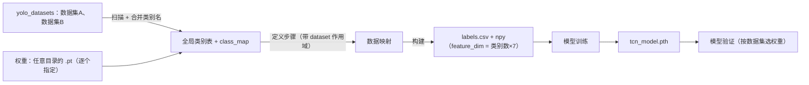

# 时序模型训练（多 YOLO 数据集 → TCN 工序步骤）需求与详细设计

> 目标：把现有的 `build_dataset.py` / `train.py` / `inference.py` 命令行流程，产品化为一个
> **单页、四步向导**的本地 Web 工具。页面名称：**时序模型训练**。
>
> **支持多个 YOLO 数据集合并**：`yolo_datasets/` 下每个子目录是一个数据集；
> 合并后共享一张全局类别表与一套 TCN 步骤。
>
> **数据集目录与权重可分离**：每个数据集分别指定**数据集目录**与 **`.pt` 文件路径**，
> 权重可放在任意目录（含不同盘符），便于移植到其它项目。

---

## 目录

**A. 需求（做什么）**

| 章节 | 内容 |
|---|---|
| §1–§2 | 背景、页面结构、全局状态条、技术约束 |
| §3 | Tab1 源数据集：多数据集勾选、权重逐个指定、全局类别表与别名 |
| §4 | Tab2 数据映射：步骤/规则、`dataset` 作用域、预览与校验 |
| §5–§6 | Tab3 训练、Tab4 验证（含预热口径 B） |
| §7–§12 | 数据契约、后端接口、状态依赖、非功能需求、验收标准、待确认问题 |

**B. 详细设计（怎么做，可直接开发）**

| 章节 | 内容 |
|---|---|
| §13 | **实现现状与开发差距**（哪些已有、哪些必须改） |
| §14 | **数据与算法规格**（发现、全局类别表、帧 ID、标签、匹配、特征、滑窗、切分、推理语义） |
| §15 | **配置与文件契约**（`tcn_config.json` / `dataset_meta.json` / `labels.csv` / `.pth` 字段表） |
| §16 | **后端详细设计**（模块、函数签名、API JSON、子进程、任务锁、路径守卫） |
| §17 | **前端详细设计**（文件结构、state、事件流、SSE、禁用矩阵） |
| §18 | **错误码与文案表** |
| §19 | **开发任务清单与实施顺序**（含每项验收） |
| §20 | **自测用例与期望数值**（真实可跑） |
| §21 | **附录**（CLI 全表、常量、术语、已知陷阱） |
| §22 | **实现备忘与运维手册**（目录结构、实现约定、前端坑、接口清单、命令、数据特性、联调前置） |

> 阅读建议：开发前先看 **§13 + §19** 确认范围与顺序；写代码时以 **§14–§18** 为准；
> 交付前用 **§20** 的用例逐条对账。

---

## 1. 背景与目标

现有链路已经跑通（**多数据集版**）：

```
yolo_datasets/<数据集A>/  images + labels + dataset.yaml + classes.txt
yolo_datasets/<数据集B>/  images + labels + dataset.yaml + classes.txt
   ↑ 权重目录在此之外也可（如 D:/models/a.pt）：数据集目录与权重路径分别配置
   → build_dataset.py → 全局类别表 + 逐数据集预测 → tcn_datasets（labels / labels.csv / npy / tcn_config.json v2）
   → train.py        → tcn_datasets/tcn_model.pth
   → inference.py    → 步骤判定结果（--dataset 或源路径自动选权重）
```

问题：全部依赖命令行，参数分散、需要记路径、日志不直观、映射规则只能手改 JSON。
更关键的是多数据集合并时…**全局类别表、类别别名、步骤作用域**这些概念在命令行里完全不可见，
配错了也不报错，只会表现为“验证指标莫名很烂”。

本工具要解决：

1. 让使用者**不碰命令行**就能完成“选数据集 → 定义步骤 → 训练 → 验证”；
2. **多数据集合并可视化**：勾选数据集、查看全局类别表、维护同义类别别名；
3. 把“YOLO 类别 → TCN 步骤”的映射变成可视化可编辑的规则，并明确作用于**哪个数据集**；
4. 训练/验证过程有**实时日志**，结束后给出模型路径与指标。

### 非目标

- 不做 YOLO 的训练（各数据集的 `<数据集>.pt` 由外部提供）
- 不做多用户/权限/远程部署
- 不做数据标注（沿用 YOLO 现有标注）
- **不兼容旧版单数据集目录结构**（`yolo_datasets/train`、`yolo_datasets/hand.pt`）：旧结构会被扫描器忽略，需先改成子目录形态

---

## 2. 总体设计

### 2.1 页面结构

单页应用，顶部标题 **时序模型训练**，下方 4 个 Tab 线性推进：

| # | Tab 名称 | 作用 | 核心动作 |
|---|---|---|---|
| 1 | **源数据集** | 选择**一个或多个** YOLO 数据集，并**分别**指定各自的 `.pt` | 扫描数据集目录、勾选数据集、逐个指定权重路径、确认全局类别表与别名、选择划分与检测参数 |
| 2 | **数据映射** | 定义“帧 → 步骤”的规则（可按数据集限定）并生成**合并后的** TCN 数据集 | 新建/编辑映射、按数据集预览、构建数据集 |
| 3 | **模型训练** | 配置超参并训练 | 开始训练、查看日志 |
| 4 | **模型验证** | 用目录或单图跑推理 | 选择数据集/来源、查看逐帧结果 |

### 2.2 全局状态条

页面顶部常驻一条状态提示，避免“改了数据还在用旧模型”：

```
数据集: 2 个（hand 30 帧 + sitting_pose 99 帧 = 129 帧, train）  |  全局类别: 6  |  特征维度: 42
步骤: 4（hand-阶段1/2/3, sitting_pose-阶段1）  |  检测器: yolo（2/2 个权重已就绪）
数据集版本: 2026-11-06 10:28  |  模型: tcn_datasets/tcn_model.pth (epoch 1, val_acc 0.21)
```

任一步产物变化后，后续步骤显示 **“需重新生成”** 标记。
状态条里的 `特征维度`（= 全局类别数 × 7）必须与 `tcn_model.pth` 记录的 `num_features` 一致，
不一致时 Tab4 直接阻断并提示“需重训”。

### 2.3 技术约束

- 前端：**纯 HTML + CSS + JavaScript**（可用原生 ES Module，不引入框架）
- 后端：**必须有一个本地 Python 服务**（Flask/FastAPI 均可），因为：
  - 需要执行 `build_dataset.py` / `train.py` / `inference.py`
  - 需要读取目录、统计图片/标签
  - 需要流式返回日志
- 前后端通过 HTTP JSON + **SSE**（或长轮询）交互
- 所有路径参数必须做白名单校验，**禁止拼接 shell 字符串**（用 `subprocess` 参数数组）

> 若不做后端，纯前端无法访问本地文件系统，也无法运行 Python，需求无法成立。

---

## 3. Tab1：源数据集（多数据集）

### 3.1 功能

默认扫描 `yolo_datasets/` **根目录**，把每个子目录当作一个数据集列出；用户可**勾选一个或多个**
参与合并。每个被勾选的数据集需要分别确定**两样东西**：

1. **数据集目录**（images + labels + `dataset.yaml` / `classes.txt`）
2. **模型权重 `.pt` 文件**（可位于**任意目录**，不要求与数据集同目录）

> 移植到其它项目时，数据集与模型往往不在一个位置（甚至不在一个盘符）。
> 因此两者**必须能分开指定**，只把 `<目录名>.pt` 当“默认推荐值”，不当硬约束。

选中集合共同决定三件事：

- **特征维度**（全局类别表大小 × 7）
- **建库时的逐数据集预测**（每个数据集用用户指定的那份 `.pt`）
- **Tab2 中可选的数据集作用域**

### 3.2 界面元素

| 区域 | 内容 |
|---|---|
| 数据集根目录 | 输入框 + `浏览…` 按钮；默认 `yolo_datasets`（仅用于**发现数据集**，与权重位置无关） |
| `重新扫描` 按钮 | 重新读取根目录，刷新数据集列表与全局类别表（**不会复制文件**，也不清掉已选权重；根目录会被记住） |
| **数据集列表** | 每个子目录一行：勾选框、名称、`task`、类别数、`kpt_shape`、图片数、状态标记 |
| **权重列（关键）** | 每行一个 .pt 选择器：路径输入框 + `浏览…` +状态（已指定/未指定/文件不存在）；默认为 `<数据集目录>/<名称>.pt` |
| 数据集详情 | 点选某个数据集后展示：划分表格、类别表格、数据质量卡、时间范围卡（同单数据集版） |
| **全局类别表** | 合并后的类别列表：全局 id、名称、来源数据集（含本地 id）、实例数、占比 |
| **别名合并** | 每个类别可“合并到另一个名字”（写 `class_aliases`），实时重算全局表与维度 |
| **检测器设置** | 检测器模式（`yolo`/`labels`）、`conf/iou/imgsz`、以及每个数据集权重状态一览 |
| **模型信息卡** | 当前选中数据集的 `.pt`：文件路径、大小、修改时间、`task`、`nc`、`names`、`kpt_shape`、可读取的 epoch/指标 |

### 3.3 字段与默认值

| 字段 | 默认值 | 说明 |
|---|---|---|
| 数据集根目录 | `yolo_datasets` | 只用于扫描数据集目录 |
| 参与合并的数据集 | 扫描到的全部数据集（需用户逐个确认） | 未勾选的完全不参与建库 |
| **每个数据集的权重路径** | `<数据集目录>/<名称>.pt`（**仅作为默认推荐值**） | 可手填或 `浏览…` 选任意位置的 `.pt`；支持绝对路径与不同盘符 |
| 使用划分 | `["train"]` | 对应 `build_dataset.py --split`，对每个数据集**分别**生效 |
| 检测器模式 | `yolo` | `yolo`=用各自权重预测；`labels`=直接人工标注（此时权重可留空） |
| `conf` | `0.25` | 所有数据集共用 |
| `iou` | `0.45` | 同上 |
| `imgsz` | `640` | 同上 |

权重选择规则：

| 场景 | 行为 |
|---|---|
| 默认识别到 `<名称>.pt` 存在 | 自动填入，状态绿色，用户可不改 |
| 未识别到（或目录已移走） | 显示“未指定”，红色标记，**有待用户指定后才能继续** |
| 用户指定的路径不存在 | 红色错误 + 保留输入值（不自动清空，避免用户丢配置） |
| 同一份 `.pt` 被多个数据集选中 | ⚠️ 警告：仅当这些数据集类别名完全一致时才合理，否则特征会错位 |

### 3.4 检测器（`.pt`）选择与信息展示

`.pt` 选择必须是 Tab1 的一等公民（不能藏在“高级设置”里），因为它同时决定：
建库时的特征来源、以及 Tab4 验证时的检测器。

交互：

1. 每行数据集右侧有路径输入框（默认填 `<数据集目录>/<名称>.pt`）+ `浏览…`；
2. `浏览…` 默认打开**上次选择的目录**，而不是数据集目录（移植后权重常在外面）；
3. 点击 `加载模型信息`（支持批量加载）后展示：

| 字段 | 来源 | 说明 |
|---|---|---|
| 文件名 / 大小 / 修改时间 | 文件系统 | 用于确认版本 |
| `task` | `model.task` | 必须与 `dataset.yaml` 的 `task` 一致 |
| `nc` / `names` | `model.names` | 与 `classes.txt` **按名称**比对（顺序可不同） |
| `kpt_shape` | `model.model.kpt_shape` | 必须与数据集一致 |
| epoch / 训练指标 | checkpoint 内（若有） | 仅展示，不参与校验 |
| 类别比对结果 | `names` vs `classes.txt` | 逐项显示命中 / 未命中 / 多余 |

模型缺类 / 多类只在**该数据集内**告警（因为建库时会经 `remap_class_ids` 做映射）：

| 情况 | 处理 |
|---|---|
| 名称集合相同但顺序不同 | ✅ 允许；按名称映射到该数据集的本地 id |
| 模型缺少数据集中的某些类别 | ⚠️ 警告：这些类别永远检测不到 |
| 模型多出数据集之外的类别 | ⚠️ 警告：这些检测会被丢弃 |
| `task` 或 `kpt_shape` 不一致 | ❌ **阻止**进入下一步 |
| 文件不存在 / 无法加载 | ❌ 阻止并显示原始错误摘要 |

### 3.5 多数据集一致性校验（扫描阶段）

| 校验项 | 规则 | 失败处理 |
|---|---|---|
| 目录形态 | 子目录含 `classes.txt` 或 `dataset.yaml` | 跳过并提示“非数据集目录” |
| `dataset.yaml` 与 `classes.txt` | `names` 必须一致（顺序可不同） | ❌ 该数据集不可勾选 |
| 至少一个划分有图片 | 每个勾选数据集都要满足 | ❌ 阻止下一步 |
| **权重已指定** | 每个勾选数据集都要有一个 `.pt` 路径（`labels` 模式可免） | ❌ 列出“未指定权重”的数据集 |
| **权重文件存在** | 校验用户指定的**实际路径**，不是约定路径 | ❌ 列出缺失清单（含完整路径与是否跨盘） |
| `.pt` 可加载 | 逐个加载 | ❌ 阻止并给出原始错误 |
| `task` 与数据集一致 | 逐数据集比对 | ❌ 阻止 |
| `kpt_shape` 一致 | **所有 `pose` 数据集的 `kpt_shape` 必须相同** | ❌ 阻止（共用同一套特征解析器） |
| 类别名重叠 | 同名 → 自动合并到同一全局槽位 | ✅ 允许，全局表里标注“由 A、B 共享” |
| 类别名疑似同义 | 如 `hand_left` / `left_hand`、`fist` / `hand_fist` | ⚠️ 提示“建议合并别名”，不强制 |
| 类别名完全不重叠 | 勾选的数据集之间没有任何共同类别 | ⚠️ 警告：模型只能学“这是哪个数据集”，不是工序 |

`pose` 与 `detect` **可以混用**（TCN 只吃框坐标，不吃关键点）；`kpt_shape` 冲突只发生在
两个 `pose` 数据集之间。

### 3.6 全局类别表与别名

- 全局 id 生成顺序 = **数据集顺序（按目录名排序）→ 数据集内类别顺序**，按名称去重后连续编号；
- 每个数据集保存 `class_map: [本地id → 全局id]`；
- 别名 `class_aliases: {"left_hand": "hand_left"}` 在生成全局表**之前**应用；
- 任何改名/合并都会改变全局槽位含义 → **必须重建数据集并重训**。

界面要求：

| 要求 | 说明 |
|---|---|
| 全局类别表只读排序展示 | **不允许拖拽改序**（顺序必须由脚本可复现地推导） |
| 每行显示来源 | `right_palm ← hand#0`、`sitting_bad ← sitting_pose#0` |
| 共享类别高亮 | 同一名称被多个数据集使用时标注 |
| 别名编辑 | 输入“把 X 当作 Y”后实时重算全局表与 `feature_dim` 预览 |
| 维度常显 | `feature_dim = 全局类别数 × 7`（`include_size`/`include_velocity` 默认开启） |

### 3.7 展示要求

- 类别实例数用横向条形图（纯 CSS 宽度百分比即可）
- 缺失/异常项用红色标记并给出原因
- 信息卡数字需带单位（帧 / 张 / 个）
- **数据集信息与模型信息并排展示**，不一致项高亮
- 数据集列表必须显示“勾选后的合并结果”：总帧数、全局类别数、`feature_dim`
- 每个数据集的 **数据集目录** 与 **权重目录** 分两列展示（便于确认“权重确实来自别处”）
- 权重路径过长时中间省略号截断，`title`/悬浮展示完整路径，可一键复制

### 3.8 进入下一步条件

至少一个数据集被勾选且扫描成功 + 每个勾选数据集都至少有一个含图片的划分 +
（检测器模式为 `labels`，或**每个**勾选数据集都已**指定** `.pt` 路径且加载通过一致性校验）+
所有 `pose` 数据集的 `kpt_shape` 一致。

---

## 4. Tab2：数据映射

### 4.1 核心概念：**步骤 ≠ 单个类别，允许多对一**

一个 TCN 步骤通常由**多个 YOLO 类别 / 多个中间状态**组合而成，并且它们按时间先后出现。
以"拧瓶盖"为例：

| 子阶段 | 画面中期望看到的对象 |
|---|---|
| 伸手 | 单手 |
| 接近/发现瓶子 | 单手 + 瓶子 |
| 拿起瓶子 | 手 + 瓶子（接触、抬起） |
| 双手拧 | 双手 + 瓶子 |

这些帧**全部标注为同一个步骤 id**（`拧瓶盖`），由 TCN 从整段轨迹形态里学习，
而不是靠单帧"出现了哪个类"来判定。

由此确定三条设计原则：

1. **多对一**：多个 YOLO 类别可以合并映射到同一个 TCN 步骤；
2. **一步骤可挂多条规则**：同一步骤下的多条规则是 **OR** 关系（满足任一即属于该步骤）；
3. **不同步骤可以共享类别**：例如"手"会贯穿多个步骤，此时必须靠时间区间或
   类别序列规则来区分，不能只靠单帧类别。

> 换句话说：**类别映射解决“这一步可能看到什么”，TCN 解决“这些观测连起来是什么动作”。**

**多数据集前提**：步骤是**全局命名空间**（所有数据集共用一套步骤 id），
但每个步骤通常**只绑定一个数据集**——“hand 的拓取”与“sitting_pose 的端坐”没有共同的时序含义，
硬合并只会让模型学到伪相关。数据集的绑定方式见 4.2.1。

如果两个数据集里的确实是**同一步骤**（例如都表示“抓起”），就给它们设置**相同的步骤编号**：
同一编号在训练时是同一个类别（帧数合并、模型只输出一个类别），但**名称必须完全一致**。
唯一编号仍必须从 0 连续，否则会多出永远无样本的幽灵类别。

### 4.2 五类映射规则

页面提供"新建映射规则"，规则挂载在步骤下，可混用（列表顺序即优先级，先匹配先得）。
规则里的类别 id **一律是全局 id**（界面展示名称 + 来源数据集，不允许直接填局部 id，避免混淆）：

| 规则类型 | 语义 | 参数 | 示例 |
|---|---|---|---|
| **`class`** | 该帧出现**任一**指定类别 | `classes: [id…]` | 看到瓶子 → 属于"拧瓶盖" |
| **`class_all`** | 该帧**同时**出现全部指定类别 | `classes: [id…]` | 手 + 瓶子 |
| **`class_sequence`** | 若干类别在窗口内**按顺序**出现 | `sequence: [[cls…], …]`、`max_gap_frames` | 单手 → 瓶子 → 双手 |
| **`time`** | 帧时间戳落在区间内 | `datetime_from/to` 或 `time_from/to` | 有完整录像时（**推荐**） |
| **`pattern` / `index`** | 帧名正则 / 全局帧号区间 | `pattern` / `index_from,to` | 文件名带工序标记、人工挑帧 |

**"拧瓶盖" 步骤的规则配置示例**（三条规则 OR）：

| # | 类型 | 参数 | 含义 |
|---|---|---|---|
| 1 | `class` | `[bottle]` | 画面里出现瓶子 |
| 2 | `class_all` | `[hand_right, bottle]` | 手和瓶子同时出现 |
| 3 | `class_all` | `[hand_left, hand_right, bottle]` | 双手持瓶（正在拧） |

> ⚠️ 现状说明：`build_dataset.py` 支持 `class` / `time` / `pattern` / `index` / `frames`。
> `class` 规则在 `steps[].match.classes` 里存**数据集本地类别名**（可多选，任一类别出现即命中），
> 建库时由 `write_labels_csv` 读取 `labels/` 每帧首列全局 id 判定；`class_all` / `class_sequence`
> 仍未实现（需要后端在生成 `labels.csv` 时展开成帧列表，或新增对应匹配类型）。

#### 4.2.1 作用域：`dataset` 字段（多数据集必填）

每条规则（以及整个步骤）都可以带一个 `dataset` 限定，表示“只在某个数据集的帧上生效”：

| 写法 | 含义 |
|---|---|
| `{"dataset": "hand", "pattern": "..."}` | 只匹配 `hand` 数据集的帧 |
| 不带 `dataset` | 对所有数据集的帧生效（**多数据集场景下危险**，见下表） |

| 风险 | 后果 |
|---|---|
| 时间区间规则不带 `dataset` | 不同数据集的时间戳互相串味，A 数据集的 10:26 帧被标成 B 的步骤 |
| 类别规则不带 `dataset` | 同名类别（如都叫 `hand`）跨数据集误命中 |
| `index` 规则不带 `dataset` | 全局排序把多个数据集混在一起，每加一个数据集序号就变 |

`build_dataset.py` **自动生成的步骤一定会带 `dataset`**；手工规则请自行补齐。
保存时若发现“跨数据集且未限定作用域”的规则，必须列出受影响帧数并告警。

单个步骤**默认只绑定一个数据集**（“hand 的抓取”与“坐姿的端坐”没有共同的时序含义）。
若确实想让一个步骤跨数据集（例如两个摄像头拍同一工序），界面上需显式勾选
“允许多数据集”，否则保存时告警。

### 4.3 步骤编辑器（一步骤多规则）

数据结构：

```
步骤 step
├─ id            唯一编号从 0..K-1 连续；同一编号可出现在多个步骤上
│                （= 跨数据集的同一步骤，名称必须一致；即训练类别下标）
├─ name          显示名（写入 checkpoint 的 class_names）
├─ description   备注（仅展示）
├─ dataset       绑定的数据集名（默认必填；勾“允许多数据集”后可为 null）
└─ rules[]       规则列表（OR 关系，按顺序匹配）
   ├─ type       class | class_all | class_sequence | time | pattern | index
   ├─ dataset    可选，覆盖步骤级作用域
   ├─ params     各类参数（类别用全局 id）
   └─ enabled    是否启用
```

界面要求：

| 元素 | 说明 |
|---|---|
| 步骤卡片 | 显示 id、名称、**绑定的数据集**、规则条数、命中帧数（按数据集分列） |
| 数据集筛选 | Tab2 顶部可按数据集过滤步骤列表（多数据集时避免看到一堆无关步骤） |
| `+ 添加步骤` | 先选数据集，再填名称，默认自动带 `dataset` 数据集 |
| `+ 添加规则` | 在步骤内新增一条规则；类别选择器只列**该数据集**的类别（按全局 id 存储） |
| 规则行 | 类型下拉 + 参数控件（类别多选 / 起止时间 / 正则 / 帧号） |
| 排序 | 步骤可上移/下移；规则可拖动排序（决定优先级） |
| 复制/删除 | 步骤级与规则级都要有 |

### 4.4 冲突与优先级

| 情况 | 处理 |
|---|---|
| 同一帧命中多条规则 | 按**步骤顺序 → 步骤内规则顺序**，先匹配先得；预览里显示实际归属 |
| 同一类别被多个步骤使用 | ⚠️ 允许（如“手”），但提示“该类别会参与多个步骤的判定” |
| 两个步骤的规则集完全相同 | ❌ 阻止：无法区分，等于把两个类合并 |
| 某条规则命中 0 帧 | ⚠️ 警告：规则无效（类别名写错或数据里没有） |
| 某帧不命中任何规则 | 该帧不写进 `labels.csv`，相关窗口自动丢弃 |
| 步骤未限定 `dataset` 却在多个数据集命中 | ⚠️ 警告，列出各数据集的命中帧数 |
| 两个数据集的同名类别被自动合并 | ⚠️ 提示“共用全局槽位 N”，如需区分请改类别名或加别名 |
| 某数据集的帧全部落在同一个步骤 | ⚠️ 红字警告：模型会退化成“识别这是哪个数据集” |

### 4.5 自动生成

提供按钮 **"按时间空隙自动生成"**，参数：

| 参数 | 默认 | 说明 |
|---|---|---|
| 时间空隙阈值 | 3 秒 | 相邻帧间隔超过该值即视为新步骤 |
| 最小帧数 | 8（=窗口长度） | 不足该帧数的段并入相邻段 |

对应 `build_dataset.py` 的 `generate_default_steps()` 行为：

- **逐个数据集分别执行**（不会跨数据集拼时间段）；
- 生成的步骤名自动带数据集前缀，例：`hand-阶段1`、`sitting_pose-阶段1`；
- `match` 里**一定带 `dataset`**；
- 无时间戳的数据集（文件名不带 `YYYYMMDD_HH_MM_SS`）无法按空隙切分，会退化为**整个数据集一个步骤**，
  此时必须提示“该数据集需手工拆步骤”，否则训练学到的只是数据集身份。

自动生成后仍可手工改成“多类别合并到同一步骤”的规则。

### 4.6 数据集参数（同页展示）

| 参数 | 默认 | 说明 |
|---|---|---|
| `window_size` | 8 | 因果窗口长度 |
| `stride` | 1 | 滑窗步长 |
| `label_mode` | `last` | 窗口标签取末帧（因果安全）或 `majority` |
| `pose_center_mode` | `bbox` | `bbox` / `keypoints` |
| `missing_strategy` | `interpolate` | 缺帧处理（`interpolate` = 因果前向填充） |
| `max_gap` | 5 | 最大可插值帧数 |
| `include_size` / `include_velocity` | true / true | 是否包含宽高 / 速度特征 |
| `session_pattern` | `^.+?__` | 录像段/数据集正则，用于阻止跳数据集切窗（**多数据集时不要置空**） |
| `val_ratio` | 0.25 | 验证集比例（**每个数据集分别**生效） |
| `gap` | 0 | 训练/验证接缝隔离窗口数 |

> 多数据集时 `session_pattern` 必须能匹配出 `<数据集>__` 前缀，否则同一个滑窗会跨数据集拼帧，
> 特征与标签会变成两个场景的混合。

### 4.7 映射预览（关键）

点击 `预览映射` 后展示：

| 指标 | 说明 |
|---|---|
| 每个步骤的帧数 | 帧级统计 |
| 每个步骤的窗口数 | 由 `帧数 - window_size + 1` 近似（需扣掉未命中帧） |
| 每条规则的命中帧数 | 定位“写错类别”的规则 |
| 未命中帧数 | 不属于任何步骤的帧 → 相关窗口会被丢弃 |
| **按数据集的帧数/窗口数** | 分组统计，用于发现“某数据集 0 窗口” |
| **步骤×数据集矩阵** | 行=步骤、列=数据集，格子里是帧数；可直观看到是否串味 |
| **全局类别表快照** | 全局 id → 名称 → 来源数据集（含本地 id） |
| **退化检测** | 某数据集的帧全部落在单一步骤 → 红字警告 |
| 冲突提示 | 规则集重复、类别跨多步骤、id 不连续、某步骤窗口数为 0 |
| `labels.csv` 预览 | 前 10 行（帧名带 `<数据集>__` 前缀） |

若某步骤窗口数为 0，必须**阻止**构建并提示（该步骤在模型里会消失）。

### 4.8 动作

| 按钮 | 行为 |
|---|---|
| `保存配置` | 写入 `tcn_datasets/tcn_config.json`（version 2，含 `source.datasets[]` 与 `class_map`） |
| `构建数据集` | 调用 `build_dataset.py`，流式显示日志 |
| `重新生成步骤` | 等价 `--reset-config`（需二次确认，会覆盖手工规则） |

构建完成后展示 `dataset_meta.json` 摘要：窗口数、帧数、特征维度、标签分布、`skipped_lines`、
训练/验证数量、`split_mode`（多数据集时应为 `grouped`）、`group_window_counts`（每个数据集的窗口数）。

> 若 `tcn_config.json` 的 `version` 不是 2（旧版单数据集结构），脚本会**自动重建**，
> 手工编辑的 `steps` 会丢失。界面在保存前应提示这一点。

### 4.9 校验规则

| 规则 | 处理 |
|---|---|
| 唯一 `id` 必须 0..K-1 连续 | 阻止保存 |
| 同一 `id` 的多个步骤名称必须一致（跨数据集同一步骤） | 阻止保存 |
| 每个步骤至少一条启用规则 | 阻止保存 |
| 规则参数不为空（类别/时间/正则至少一个） | 阻止保存 |
| 类别 id 必须落在**全局**类别表范围内 | 阻止保存 |
| 规则里的类别必须属于该步骤绑定的数据集 | 阻止保存（局部 id 与全局 id 混淆最容易出错） |
| 每个步骤至少 `window_size` 帧 | 阻止构建 |
| **每个勾选数据集至少被一个步骤命中** | 阻止构建（否则白选了该数据集） |
| 两个步骤规则集完全相同 | 阻止构建 |
| 时间区间重叠 | 警告（重叠部分按先匹配先得） |
| 某数据集的帧全部落在单一步骤 | 警告（可继续，但验证指标没有意义） |
| `skipped_lines` 必须为 0 | 构建后校验，非 0 时高亮报错 |

---

## 5. Tab3：模型训练

### 5.1 参数分组

**数据参数**

| 参数 | 默认 | 说明 |
|---|---|---|
| 数据集配置 | `tcn_datasets/tcn_config.json` | 只读展示 |
| 合并概览（只读） | — | 数据集数量、总帧数、全局类别数、`feature_dim`、步骤数 |
| 窗口长度 / 步长 | 取配置 | 可覆盖 |
| 验证比例 / `gap` | 取配置 | 可覆盖 |
| 使用缓存 npy | 否 | 对应 `--from-npy` |

> **切分口径**：多数据集合并后**必须按数据集分组各自时序切分**
> （`data_processor.grouped_split_indices`，meta 里 `split_mode=grouped`），
> 不能对全体样本整体切分——否则样本量最大的数据集会独占验证集，
> 其余数据集只剩下训练样本，`val_acc` 就失去意义。
> 页面需展示每个数据集的 train/val 窗口数。

**模型结构**

| 参数 | 默认 | 说明 |
|---|---|---|
| `channels` | `64 64 64 64` | 每层通道数，层数决定感受野 |
| `dropout` | 0.2 | |

**优化参数**

| 参数 | 默认 | 说明 |
|---|---|---|
| `epochs` | 80 | |
| `batch_size` | 16 | |
| `lr` | 0.001 | |
| `seed` | 42 | |
| `device` | `auto` | auto / cpu / cuda |
| `checkpoint` 输出路径 | `tcn_datasets/tcn_model.pth` | 可改 |

### 5.2 交互

- `开始训练` → 建立 SSE 通道，逐行推送日志
- 日志区需处理 `tqdm` 的 `\r`（按行覆盖，不要把进度条刷成几百行）
- 解析 `epoch 003 | train_loss=... | val_loss=... | val_acc=...` 生成曲线（可选）
- 提供 `停止训练`（终止子进程）
- 训练中禁用参数编辑

### 5.3 完成展示

| 项 | 内容 |
|---|---|
| 模型路径 | **绝对路径**，可复制 |
| 最优 epoch / val_acc | 来自 checkpoint 的 `metrics` |
| **按数据集分组的验证准确率** | 用 `val` 帧所属分组回算，避免“整体指标被大数据集拉高”（可选，建议做） |
| 参数量 / 感受野 | 来自训练日志 |
| 训练耗时 | 后端计时 |
| 产物列表 | `tcn_model.pth`、`dataset_meta.json`、4 个 npy |

### 5.4 前置校验

| 规则 | 提示 |
|---|---|
| `labels.csv` 存在 | "请先在【数据映射】生成数据集" |
| 窗口数 ≥ 4 | "样本过少，仅适合验证链路" |
| 验证集非空 | "验证集为空，请调小 gap 或增大数据量" |
| 至少两个步骤有窗口 | “某步骤窗口数为 0，该步骤在模型里会消失” |
| `feature_dim` 与当前勾选数据集一致 | “数据集已变更，请重新构建后再训练” |

---

## 6. Tab4：模型验证

### 6.1 输入来源

单选：

| 来源 | 说明 | 限制 |
|---|---|---|
| **目录** | 图片目录（jpg/png） | **最多 50 张**，只统计用户选中的图片；**预热帧不计入**；扫描后提供「全选 / 取消全选」；超出直接拒绝 |
| **单张图片** | 单文件 | 自动借用同目录前置帧预热（数量 ≤ `window_size-1`），预热帧不计入 50 张上限 |

一个目录/一次验证只能属于**一个数据集**（因为只能用一个检测器）：
若选中的图片分散在多个数据集目录下，必须拆分多次验证，或直接拒绝。

### 6.2 参数

| 参数 | 默认 | 说明 |
|---|---|---|
| 模型路径 | `tcn_datasets/tcn_model.pth` | 必填 |
| **所属数据集** | `自动` | `自动` = 按图片路径归属判断；否则从勾选列表选；也可手动指定（对应 `--dataset`） |
| 模型权重 | 读自 `tcn_config.json` 的 `source.datasets[].weights`（**用户此前指定的任意路径**） | 只读展示完整路径；若该路径已失效，提供“重新选择”入口，避免卡死 |
| `conf` / `iou` / `imgsz` | 0.25 / 0.45 / 640 | 必须与建库时一致 |
| 平滑窗口 `smooth` | 5 | 概率滑动平均 |
| 窗口长度 | 来自 checkpoint（只读） | 防止误改 |

数据集判定优先级（与 `inference.py` 一致）：`--dataset` > `--source` 路径归属 > 路径目录名与数据集名匹配（取最靠近图片的一层）> 唯一数据集兜底。
判断不出来时必须**报错并列出可选数据集名**，不能默默按第一个数据集处理。

### 6.3 预热与帧数不足的处理

**口径 B：50 张上限只约束“用户选择待验证的图片”，不包含预热帧。**

| 场景 | 行为 |
|---|---|
| 目录模式 | 只喂所选目录内的图片，**不跨目录借用**；前 `window_size-1` 帧仅预热、不输出 |
| 目录图片数 ≤ `window_size-1` | **不报错阻断**，照常执行，输出 0 条，并提示“帧数不足：需要 N 帧，实际 M 帧” |
| 单图模式，同目录总数 ≥ `window_size` | 取该图 + 前 `window_size-1` 张，输出 1 条 |
| 单图模式，同目录总数 < `window_size` | **不报错**，按现有帧数推流，输出 0 条并提示“帧数不足（需要 8，实际 5）”；不再强制要求预热帧 |
| 单图是该目录第 1 张 | 前面无可预热帧 → 输出 0 条并提示“该图前面没有可用于预热的帧” |

明确不做：

- ❌ 不做零填充补齐（会让输入分布偏离训练集，结果不可信）
- ❌ 预热帧不占用 50 张额度
- ❌ 不跨目录借帧

界面必须在点击前显示预计工作量：

```
目录模式：已选择 50 张  →  预热 7 帧，预计输出 43 条
单图模式：1 张目标 + 7 张预热（共 8 帧）→ 预计输出 1 条
单图模式：目录仅 5 张  →  帧数不足（需要 8），预计输出 0 条
```

> 实现提示：当前 `inference.py` 在单图帧数不足时会抛 `SystemExit`。
> Web 层不能把它当失败，应捕获后转为“输出 0 条 + 提示”，
> 或后续把 `inference.py` 改为返回空结果。

### 6.4 结果展示

- **逐帧表格**：`frame_id`、步骤号、步骤名、置信度（多数据集时额外列“所属数据集”）
- **时间线**：每帧一个色块，按步骤着色
- **汇总**：输出次数、各步骤占比、平均置信度
- **工作量**：实际处理帧数、预热帧数、预计输出条数
- **日志区（验证日志）**：位于「验证来源」与「验证结果」之间，点击开始验证后实时追加——
  `inference.py` 逐张打印 `[i/N] 图片名 → 检测 K 个目标`（预热帧也打印），
  窗口填满后追加 `[i/W] 帧名 -> 步骤 X (名称) 置信度 y`；结束时显示 `共输出 N 次预测`
- `导出 CSV`：导出逐帧结果

### 6.5 校验与提示

| 情况 | 处理 |
|---|---|
| 目录图片 > 50 | 拒绝并提示“最多 50 张”（仅统计用户选中图片） |
| 目录图片数 < `window_size` | **允许执行**；结果区提示“帧数不足，输出 0 条” |
| 单图目录总帧数 < `window_size` | **允许执行**；提示“需要 N 帧，实际 M 帧” |
| 单图前面无预热帧 | 允许执行；提示“前面没有可预热帧” |
| 模型路径不存在 | 阻止运行 |
| 图片不属于任何已知数据集 / 跨多个数据集 | 阻止并列出可选数据集 |
| 特征维度不匹配 | 直接显示后端报错原文（并提示“数据集已变更，需重建 + 重训”） |

---

## 7. 数据契约

### 7.1 目录

```
yolo_datasets/                     # 根目录：每个子目录 = 一个数据集（只含数据）
├─ hand/
│  ├─ hand.pt                      # 可选：仅作为默认推荐位置
│  ├─ classes.txt
│  ├─ dataset.yaml
│  └─ train|val|test/{images,labels}/
└─ sitting_pose/
   ├─ classes.txt
   ├─ dataset.yaml
   └─ train|val|test/{images,labels}/

D:/models/                         # 权重可在任意目录（含不同盘符）
├─ hand_v3.pt
└─ sitting_pose_best.pt

tcn_datasets/
├─ tcn_config.json                 # version 2，含 source.datasets[] 与 class_map
├─ labels/*.txt                    # 文件名 = <数据集>__<原帧名>.txt
├─ labels.csv                      # frame,label,step_name（frame 带数据集前缀）
├─ X_train.npy / y_train.npy / X_val.npy / y_val.npy
├─ dataset_meta.json               # 含 group_window_counts / split_mode
└─ tcn_model.pth
```

旧版形态（`yolo_datasets/classes.txt`、`yolo_datasets/hand.pt` 直接放在根目录下）**不再支持**，
扫描器会跳过根目录下的非子目录文件并提示迁移。

> 权重与数据集目录**完全解耦**：`yolo_root` 只用于**发现数据集**，不参与权重定位；
> 每个数据集的权重是 `source.datasets[].weights` 里记录的**独立绝对路径**。
> `<数据集目录>/<名称>.pt` 只是“首次扫描时的默认推荐值”。

### 7.2 `tcn_config.json`（version 2）

```json
{
  "version": 2,
  "source": {
    "yolo_root": "C:/Users/WXZZ/Desktop/因果TCN事例/yolo_datasets",
    "detector_defaults": {"type": "yolo"},
    "datasets": [
      {
        "name": "hand",
        "path": ".../yolo_datasets/hand",
        "weights": "D:/models/hand_v3.pt",
        "task": "pose",
        "kpt_shape": [20, 3],
        "classes": ["right_palm", "left_palm", "right_fist", "left_fist"],
        "class_map": [0, 1, 2, 3]
      },
      {
        "name": "sitting_pose",
        "path": ".../yolo_datasets/sitting_pose",
        "weights": ".../yolo_datasets/sitting_pose/sitting_pose.pt",
        "task": "detect",
        "kpt_shape": null,
        "classes": ["sitting_bad", "sitting_good"],
        "class_map": [4, 5]
      }
    ]
  },
  "class_aliases": {},
  "object_classes": {
    "num_target_classes": 6,
    "target_names": ["right_palm", "left_palm", "right_fist", "left_fist",
                     "sitting_bad", "sitting_good"],
    "kpt_shape": [20, 3],
    "tasks": {"hand": "pose", "sitting_pose": "detect"}
  },
  "dataset": {
    "window_size": 8, "stride": 1, "label_mode": "last",
    "pose_center_mode": "bbox", "missing_strategy": "interpolate",
    "max_gap": 5, "include_size": true, "include_velocity": true,
    "session_pattern": "^.+?__", "val_ratio": 0.25, "gap": 0
  },
  "steps": [
    {"id": 0, "name": "hand-阶段1", "match": {"dataset": "hand",
      "datetime_from": "2026-09-03 10:26:09", "datetime_to": "2026-09-03 10:26:31"}},
    {"id": 1, "name": "sitting_pose-阶段1", "match": {"dataset": "sitting_pose",
      "frames": ["sitting_pose__xxx", "..."]}}
  ],
  "unmatched": null
}
```

关键字段：

| 字段 | 说明 |
|---|---|
| `source.datasets[].path` | 数据集目录（仅用于定位 images/labels，与权重无关） |
| `source.datasets[].weights` | 该数据集实际使用的 `.pt` **绝对路径**，可指向任意目录/盘符；`labels` 模式可为 `null`。**这是权威值，不得被扫描结果覆盖** |
| `source.datasets[].class_map` | 本地类别 id → **全局槽位**；由脚本按类名并集推导，不要手改 |
| `object_classes.target_names` | 全局类别表，`feature_dim = len(target_names) × 7` |
| `object_classes.tasks` | 数据集名 → task 的映射（`pose`/`detect`/`seg`/`obb` 可混合） |
| `class_aliases` | 同义类别合并，例 `{"left_hand": "hand_left"}` |
| `dataset.session_pattern` | 默认 `^.+?__`，保证滑窗不跨数据集 |

支持的 `match` 键：`dataset` / `frames` / `pattern` / `datetime_from|to` / `time_from|to` / `index_from|to`
（**新增**：`class`、`class_all`、`class_sequence`）。

> **代码特实现（两项）**
> 1. `build_dataset.py` 目前只认约定路径 `<数据集目录>/<名称>.pt`，且每次运行会用扫描结果
>    **覆盖** `source.datasets[].weights`。需改为：配置里已有 `weights` 时**优先采用并保留**，
>    仅在缺失时才回退到约定路径。
> 2. 需新增命令行参数传递“数据集 → 权重”映射（建议 `--weights hand=D:/models/hand_v3.pt`，
>    可重复），供 Web 后端调用；`inference.py` 已能从配置读取 `weights`，无需改动。
>
> 另外：`detector_defaults` 目前只存 `type`，建议补上 `conf/iou/imgsz`，
> 以便建库与验证自动校验一致性；未补前由界面/文档约定“两处必须一致”。

一个步骤可以包含**多条规则**，推荐持久化为 `rules[]`：

```json
"steps": [
  {
    "id": 3,
    "name": "拧瓶盖",
    "description": "单手 → 瓶子 → 双手",
    "rules": [
      {"type": "class",     "classes": [1]},
      {"type": "class_all", "classes": [0, 2]},
      {"type": "class_all", "classes": [0, 1, 2]}
    ]
  }
]
```

兼容策略（降低现脚本改动）：

| 情况 | 写入方式 |
|---|---|
| 步骤只有 1 条规则且为 `time`/`pattern`/`index`/`frames` | 直接归一化为现有 `match` 对象 |
| 步骤有多条规则，或含 `class*` 规则 | 后端先扫描 `labels/`，展开为 `match: {"frames": [...]}` |
| 步骤只有 `class*` 规则且数据量大 | 建议给 `build_dataset.py` 新增对应匹配类型，避免帧列表过长 |

### 7.3 `labels.csv`

```csv
frame,label,step_name
sitting_pose__istockphoto-1427875337-612x612_jpg.rf.55be67df…,3,sitting_pose-阶段1
hand__WIN_20260903_10_26_09_Pro,0,hand-阶段1
```

- `frame` = **`<数据集>__<原帧名>`**，与 `labels/<frame>.txt` 一一对应（不区分大小写）
- 只有 `frame` 和 `label` 参与训练；`step_name` 仅用于展示
- `label` 是**全局步骤 id**（"步骤"命名空间，与对象类别 id 完全无关）

### 7.4 逐帧标签 txt

- `detect`：`class cx cy w h`
- `pose`：`class cx cy w h` + `K×D` 个关键点（本数据集 65 个数）
- 坐标归一化到 `[0, 1]`；无目标的帧写空文件（`mask=0`）
- **`class` 一律是全局类别 id**：建库时已按 `class_map` 重映射，
  因此不同数据集的同类目标会落在同一个特征槽位上
- 标签文件名也带数据集前缀（`<数据集>__<原帧名>.txt`），但**文件内容不加前缀**

---

## 8. 后端接口建议

| 方法 | 路径 | 入参 | 出参 |
|---|---|---|---|
| GET | `/api/dataset/scan` | `root`（省略时用上次使用的根目录 → 配置里的 `source.yolo_root` → 默认） | 根目录下 `datasets[]`（见 3.2，含每个数据集**当前保存的权重路径**与默认推荐路径）+ 全局类别表 + `feature_dim` 预览 |
| POST | `/api/datasets/validate` | `{detector, datasets:[{name, weights}]}` | 一致性校验结果（权重缺失 / kpt_shape 冲突 / 类别不重叠警告） + 每个 `.pt` 的元信息 |
| GET | `/api/images/scan` | `path` | 图片数、文件名列表（Tab4 的 50 张上限预检，见 §16.4） |
| GET | `/api/images/thumb` | `path` + `name` | 该图片二进制（Tab4 列表缩略图；只读，拒绝目录穿越与非图片后缀） |
| GET | `/api/dataset/meta` | — | `dataset_meta.json`（页面刷新后恢复训练/验证页摘要） |
| GET | `/api/config` | — | `tcn_config.json` |
| PUT | `/api/config` | 配置对象（含 `class_aliases`、`steps`） | 校验结果（含全局类别表回写） |
| POST | `/api/dataset/build` | 配置 + 检测参数 | SSE：`log` / `done` |
| POST | `/api/train` | 训练参数 | SSE：`log` / `metric` / `done` |
| POST | `/api/train/stop` | — | `{ok}` |
| POST | `/api/validate` | 来源 + 参数（含 `dataset`） | SSE：`log` / `prediction` / `done` |
| POST | `/api/fs/pick` | `mode=dir|file`、`filters`（如 `*.pt`）、`start`（初始目录） | 绝对路径（**不限工作区**） |

SSE 事件约定：

```
event: log
data: {"level":"info","text":"..."}

event: metric
data: {"epoch":3,"train_loss":0.12,"val_acc":0.75}

event: done
data: {"ok":true,"result":{...}}

event: error
data: {"message":"..."}
```

> 子进程使用参数数组启动（如 `[python, "build_dataset.py", "--detector", "yolo", "--weights", "hand=D:/models/hand_v3.pt", ...]`），
> 统一 `PYTHONUTF8=1`，并按 `\r` 拆分 stdout 以承载 tqdm。
> 权重路径可能在工作区之外，**不能**当成非法路径拒绝（只限只读加载）。

---

## 9. 状态依赖与失效规则



| 变更 | 需要重新构建数据集 | 需要重新训练 |
|---|---|---|
| 勾选/取消勾选数据集 | ✅ | ✅（`feature_dim` 可能变） |
| 换数据集根目录 / 划分 | ✅ | ✅ |
| 改某个数据集的**权重路径**（换成另一份 `.pt`） | ✅ | ✅ |
| 原地重训同名 `<名称>.pt`（内容变了） | ✅ | ✅ |
| 改检测器模式 / conf / iou / imgsz | ✅ | ✅ |
| 改类别别名 `class_aliases` | ✅ | ✅（全局槽位重排） |
| 改步骤映射（含 `dataset` 作用域）/ 窗口参数 | ✅ | ✅ |
| 改训练超参（epochs/lr/channels…） | ❌ | ✅ |
| 只改步骤显示名 | ✅（labels.csv 同步） | ✅（class_names 进 checkpoint） |

---

## 10. 非功能需求

| 项 | 要求 |
|---|---|
| 语言 | 中文界面，文案与本文一致 |
| 路径 | 支持中文与空格（Windows） |
| 性能 | 单数据集（30 张）扫描 < 2s；两个数据集（130 帧）建库 < 60s（含 YOLO 推理）；训练进度实时刷新 |
| 日志 | 保留最近一次运行的完整日志，可复制/下载 |
| 错误 | 后端异常必须回传原始错误摘要，不能只显示"失败" |
| 恢复 | 训练中断时 checkpoint 保留最后一轮已保存的权重 |
| 安全 | 数据目录限制在工作区根目录内；**权重文件例外**（允许工作区外路径，但只做只读加载，不做写操作） |
| **可复现** | 同一组数据集 + 同一份 `class_aliases` 必须推导出**完全相同**的全局类别表与 `class_map`（按目录名、类别顺序固定排序） |
| **可追溯** | 每个步骤必须能回答“它属于哪个数据集、命中哪些帧”，`labels.csv` 的帧名带数据集前缀 |

---

## 11. 验收标准

**多数据集发现与合并（Tab1）**

1. 打开页面，扫描 `yolo_datasets/` 后列出 **2 个数据集**：`hand`（pose，4 类，`kpt_shape=[20,3]`，权重存在）与 `sitting_pose`（detect，2 类，无 `kpt_shape`，权重存在），并显示各自 train/val 图片数。
2. 勾选两个数据集后，全局类别表显示 **6 个类别**（`right_palm, left_palm, right_fist, left_fist, sitting_bad, sitting_good`），`class_map` 分别为 `[0,1,2,3]` 与 `[4,5]`，`feature_dim` 预览为 **42**。
3. 删除 `sitting_pose/sitting_pose.pt` 后重新扫描 → 该行权重状态变红（“未指定”），进入下一步被阻止，提示“缺少 YOLO 权重：sitting_pose（请指定 .pt 路径）”。
4. **权重与数据集目录分离**：把两个 `.pt` 拷到 `D:\models\`（与 `yolo_datasets` 不同盘），逐个用 `浏览…` 选中并加载模型信息 → 状态变绿，可以进入下一步；构建后 `tcn_config.json` 的 `weights` 保存的是 `D:/models/...` 绝对路径。
5. 模拟“移植到其它项目”：整体拷走 `yolo_datasets` 与 `tcn_datasets`，权重仍留在 `D:\models\` → 重新扫描后权重路径不变、无需重新指定；再手动把其中一个路径改成不存在的文件 → 报“文件不存在: D:/models/xxx.pt”，且保留已输入的路径不清空。
6. 把两个 `pose` 数据集的 `kpt_shape` 改成不同值 → 校验报错并阻止；把其中一个改成 `detect` → 允许（可混用）。
7. 给 `hand` 加别名 `{"right_palm": "palm"}` 且 `sitting_pose` 里也有 `palm` → 全局类别数减 1，`feature_dim` 同步变化，并提示“此项已变更，需重建+重训”。

**数据映射（Tab2）**

8. 在 `hand` 下新建步骤“拧瓶盖”，挂 3 条类别规则（`bottle` / `hand+bottle` / `双手+bottle`），预览显示每条规则命中帧数、步骤×数据集矩阵、合并后帧数与窗口数；保存后 `labels.csv` 中这些帧标同一个步骤 id，且帧名带 `hand__` 前缀。
9. 新建一条不带 `dataset` 的时间区间规则，使其同时命中两个数据集 → 保存时告警并列出各数据集命中帧数。
10. 让 `sitting_pose` 的 99 帧全部落在一个步骤里 → 预览给出退化警告“该数据集只学到数据集身份”。

**构建（Tab2 → 产物）**

11. 点击“构建数据集”，日志实时输出（YOLO 加载、逐数据集预测帧数、步骤统计），结束后 `dataset_meta.json` 满足：`skipped_lines = 0`、`num_frames = 129`、`num_windows = 115`、`feature_dim = 42`、`sessions = 2`、`split_mode = "grouped"`，且 `group_window_counts` 含两个数据集；日志中应能看到每个数据集实际加载的 `.pt` 完整路径。

**训练（Tab3）**

12. 修改 `epochs` 与 `channels` 后训练，逐 epoch 日志可见；结束后显示 `tcn_datasets/tcn_model.pth`、`num_features = 42`、`class_names` 为 4 个步骤、`val_acc`，并展示每个数据集的 train/val 窗口数。

**验证（Tab4）**

13. 选 `yolo_datasets/hand/train/images`（30 张，未超过 50 张上限 → 扫描后默认全选，可点「取消全选」后手动勾选）；目录图片 > 50 张时提示超限；改选 ≤50 张可正常输出，界面显示“预计输出 = 图片数 − (window_size−1)”；单图模式显示预热帧数并输出 1 条；目录总帧数 < `window_size` 时不报错，输出 0 条并提示“帧数不足”。
14. 选 `yolo_datasets/sitting_pose/train/images` → 自动判定数据集为 `sitting_pose` 并加载**配置里记录的权重路径**（日志可见）；把图片复制到 `D:\temp` 后再验证 → 提示“无法判断所属数据集，请指定”，并可手动选择。
15. 用一个删掉了 `sitting_pose` 的旧 `tcn_model.pth`（`num_features=28`）验证 → 阻断并提示“特征维度不匹配：权重期望 28，当前 42，需重训”。

**状态依赖**

16. 修改数据映射或勾选集合后，状态条提示“数据集需重新生成”，未重建时训练按钮给出阻断提示。

---

## 12. 待确认问题

1. ~~**类别映射的语义**：把 YOLO 类别直接映射成工序步骤是否合理？~~
   **已确认**：允许**多对一**——一个步骤可以挂多条类别规则（`class` / `class_all`），
   把“单手 → 瓶子 → 双手”这类中间状态合并到同一步骤，由 TCN 学整段时序。
2. `class_sequence`（顺序规则）是否必须？如果只用 `class` / `class_all` 能覆盖现有工序，
   可先不做，实现复杂度会明显降低。
3. ~~Tab4 目录上限 50 张是否包含单图模式的前置预热帧？~~
   **已确认（口径 B）**：50 张只统计用户选中的图片，预热帧不计入；
   目录或单图帧数不足时**不报错阻断**，而是输出 0 条并提示帧数不足。
4. ~~是否需要“多数据集合并”（多个 yolo 目录 + 全局类别表）？~~
   **已确认（需要）**：`yolo_datasets/` 下每个子目录是一个数据集，可勾选多个合并；
   按**类别名并集**建全局类别表（`class_aliases` 合并同义异名），
   帧名加 `<数据集>__` 前缀隔离，步骤用 `match.dataset` 限定作用域，
   训练/验证按数据集分组各自时序切分。详见 §3.5、§4.2.1、§5.1、§7.2。
5. 训练是否需要实时曲线，还是日志足够？
6. 页面是否需要历史运行记录（多次训练对比）？
7. ~~是否允许权重文件与数据集目录分离？~~
   **已确认（必须支持）**：数据集目录与 `.pt` 路径**分别指定**。移植到其它项目时两者常不在同一位置，
   `<数据集目录>/<名称>.pt` 只当默认推荐值；`yolo_root` 仅用于发现数据集。详见 §3.1–§3.5、§7.2。
8. **步骤是否允许跨数据集**（一个步骤同时覆盖多个数据集的帧）？
   现状：脚本允许（规则不写 `dataset` 即全局生效），但语义上多数场景应该禁止。
   建议界面默认禁止，需显式勾选“允许多数据集”。**待确认。**
9. **数据集私有步骤的可见性**：某步骤只绑定了数据集 A，验证 B 的图片时它必然不可能命中，
   是否需要在 Tab4 结果里隐藏/置灰这些步骤？**待确认。**

---

# B. 详细设计

## 13. 实现现状与开发差距

### 13.1 能力盘点（截至 2026-11-06）

图例：✅ 已实现且可用 ｜ ⚠️ 有实现但契约未定 ｜ ❌ 未实现

| 能力 | 状态 | 代码位置 |
|---|---|---|
| 多数据集目录发现 | ✅ | `build_dataset.discover_datasets` |
| 元信息解析（`classes.txt` / `dataset.yaml`） | ✅ | `build_dataset.read_yolo_meta` |
| 跨数据集一致性校验（`kpt_shape` / 权重） | ✅ | `build_dataset.validate_datasets` |
| 全局类别表 + `class_map` | ✅ | `build_dataset.build_global_classes` |
| 类别别名 `class_aliases` | ✅（仅从既有配置读取） | `build_dataset.main` |
| 逐数据集 YOLO 预测 → 全局 id 标签 | ✅ | `write_predictions_for_dataset` |
| `labels` 模式人工标注重映射 | ✅ | `write_labels_for_dataset` |
| 陈旧标签清理 | ✅ | `sync_dataset_labels` |
| `labels.csv` 生成 | ✅ | `write_labels_csv` |
| 默认步骤生成（按数据集 + 时间空隙） | ✅ | `generate_default_steps` / `merge_small_groups` |
| 步骤匹配（`dataset`/`frames`/`pattern`/时间/`index`） | ✅ | `match_step` |
| 单步退化告警 | ✅ | `warn_single_step_datasets` |
| 帧聚合 / 特征布局 / 流式特征 | ✅ | `aggregate_detections` / `FrameFeatureAssembler` |
| 因果滑窗 | ✅ | `make_causal_windows` |
| 分组切分（导出 npy 侧） | ✅ | `grouped_split_indices` / `export_dataset` |
| **训练侧使用分组切分** | ❌ **不一致** | `train.main` 仍用 `chronological_split_indices` |
| **权重路径以配置为准（不被扫描覆盖）** | ❌ | `refresh_config_dataset_state` |
| **CLI `--weights name=path`** | ❌ | `build_dataset.main` |
| `detector_defaults` 落盘 `conf/iou/imgsz` | ❌ | `load_or_create_config` |
| 规则类型 `class` / `class_all` / `class_sequence` | ❌ | 仅文档提出，`match_step` 未支持 |
| Web 后端（Flask + SSE） | ❌ 未开始 | — |
| Web 前端（4 Tab） | ❌ 未开始 | — |
| 单图帧数不足时的退出码契约 | ⚠️ 行为已有（warning + 0 条），退出码未定义 | `inference.main` |

### 13.2 必须修复的 3 个缺陷（动 Web 层之前先修）

| # | 缺陷 | 后果 | 修复规格 |
|---|---|---|---|
| D1 | `train.py` 用 `chronological_split_indices(dataset.X.shape[0], ...)`，而 `export_dataset` 用 `grouped_split_indices` | 训练用的 val 与导出的 `X_val.npy` **不是同一批**；"每个数据集都有验证样本"的承诺失效 | 新增 `data_processor.split_dataset(dataset, val_ratio, gap) -> (train_idx, val_idx)`，`export_dataset` 与 `train.main` **共用**它；`train.main` 删除对 `chronological_split_indices` 的直接调用 |
| D2 | `refresh_config_dataset_state` 每次用扫描结果重写 `source.datasets[].weights` | 用户指定的外部权重路径被覆盖回 `<数据集>/<名称>.pt`，下次构建直接用错模型 | 权重解析改为优先级链（见 §14.1.3）：`--weights` > 配置既有值（文件存在）> 约定路径（存在）> `null`；写入时保留用户值 |
| D3 | `detector_defaults` 仅 `{"type": "yolo"}` | 无法校验"建库与验证的 `conf/iou/imgsz` 是否一致" | 写入 `{"type": "yolo", "conf": 0.25, "iou": 0.45, "imgsz": 640}`；Tab4 启动前比对，不一致给阻断/告警 |

### 13.3 可直接复用的既有实现（禁止重写）

| 模块 | 复用点 |
|---|---|
| `detectors.py` | `load_yolo` / `detect_with_yolo` / `remap_class_ids` / `format_detection_line` / `IMAGE_SUFFIXES` —— **YOLO→Detection 的唯一实现** |
| `data_processor.py` | `YoloParserFactory` / `Detection` / `aggregate_detections` / `FrameFeatureAssembler` / `interpolate_missing` / `make_causal_windows` / `natural_frame_key` / `CsvLabelProvider` / `SequenceDatasetBuilder` / `export_dataset` |
| `build_dataset.py` | `read_yolo_meta` / `discover_datasets` / `validate_datasets` / `build_global_classes` / `match_step` / `write_labels_csv` / `build_data_config` |
| `train.py` | `ArrayDataset` / `fit_normalization` / `apply_normalization` / `compute_class_weights` / `run_epoch` / `save_checkpoint` |
| `inference.py` | `RealtimeActionRecognizer` / `load_dataset_registry` / `resolve_dataset` / `run_stream` / `collect_image_context` |

> Web 层**只做编排**：扫描、拼参数、起子进程、解析日志、读写配置、渲染结果。
> 任何"再算一遍特征/再解析一遍标签"的实现都属于重复代码，必须拒绝。

### 13.4 本轮已落地（2026-11-06）

| 项 | 状态 | 落点 |
|---|---|---|
| D1 训练/导出切分不一致 | ✅ 已修复 | `data_processor.split_dataset`（导出与训练共用）；`train.py` 改用该函数；`--from-npy` 直接使用已导出的四个 npy，不再二次切分 |
| D2 权重被扫描覆盖 | ✅ 已修复 | `build_dataset._resolve_dataset_weights`（CLI > 配置 > 约定路径）+ `dataset_snapshots` 持久化 `weights/default_weights/weights_previous` |
| D3 检测参数未落盘 | ✅ 已修复 | `source.detector_defaults = {type, conf, iou, imgsz}` |
| T0.3 `--weights NAME=PATH` | ✅ 已实现 | `build_dataset.py --weights`（可重复，路径可含 `=`） |
| T0.5 帧数不足退出码 | ✅ 已确认 | `inference.py` 返回 0 + `共输出 0 次预测` |
| T0.6 回归测试 | ✅ 已补 | `tests/test_multi_dataset.py`（14 项，全局类别表/分组切分/特征等价/匹配优先级/权重解析）→ 合计 **33 passed** |
| 阶段二 后端 | ✅ 已实现 | `web_server.py` + `web/services/*`（scan/validate/meta/images/config/build/train/validate/stop/pick + SSE + 单任务锁） |
| 阶段三 前端 | ✅ 已实现 | `web/index.html`、`web/css/*`、`web/js/*`（4 Tab、state 驱动、POST-SSE 客户端、textContent 渲染） |
| `class` / `class_all` / `class_sequence` | ❌ 未实现 | 界面暂不提供 `class_all/class_sequence`；`match_step` 支持 classes/time/pattern/frames/index |
| 训练曲线 / 历史记录 | ❌ 未实现 | §12 待确认项，当前在日志中展示逐 epoch 指标行（高亮） |

验证结果（可复现）：

| 用例 | 结果 |
|---|---|
| `GET /api/dataset/scan` | 2 个数据集，`target_names` 6 项，`feature_dim=42` |
| `POST /api/datasets/validate` | `ok=true`，两个 `.pt` 的 `task`/`kpt_shape` 均匹配 |
| `POST /api/dataset/build`（SSE） | `done.result.meta`：129 帧 / 115 窗口 / 42 维 / 4 步 / grouped / 86-29 / `skipped_lines=0` |
| `POST /api/train`（SSE） | 逐 epoch `metric` 事件；`done.result`：`val_acc`、`feature_dim=42`、`split_mode=grouped` |
| `POST /api/validate`（SSE） | hand 目录选 10 张 → `outputs=3`、`warmup=7`、自动判定 `dataset=hand` |
| 目录 60 张不裁剪 | 返回 `E_TOO_MANY_IMAGES`（"最多 50 张，当前 60 张"） |

### 13.5 第二批~第四批修复（2026-11-06）

| 项 | 修复 |
|---|---|
| 验证口径 | 标签回放优先 `labels.csv`；按 `session_pattern` 分段并重置；回放 `kpt_shape` 取自 checkpoint |
| 缺失值 | 训练/推理统一为**因果前向填充**（`interpolate_missing` / `CausalMissingFiller`） |
| 勾选语义 | Tab1 勾选 = 建库范围；未勾选 → `--exclude-dataset` |
| 删除数据集 | purge 时清理引用它的 `steps` 并压缩编号；构建时失效 scope 仅告警 |
| 规则校验 | 保存与构建都会校验正则/时间/帧号/空规则（`E_STEP_RULE_INVALID`） |
| 构建前保存 | Tab2 构建前自动保存配置（无配置时由构建生成） |
| 新增数据集 | 没有任何步骤覆盖的数据集自动追加默认步骤，不再静默排除 |
| 零帧/零窗口 | 每个步骤必须有帧命中且有窗口，否则构建失败并列出步骤 |
| 训练防护 | ≥2 个步骤；验证集不得出现训练集没有的类别；`--from-npy` 校验窗口/特征/类别数一致 |
| 验证防护 | 同时校验特征维度与类别数；结果步骤名以当前配置为准；单图预热/预计输出修正 |
| 路径 | 数据集根、checkpoint 允许工作区外；`tcn_dir` / 配置仍在工作区内 |
| 状态与并发 | 任务运行中禁止保存配置/增删数据集/导入权重（`E_TASK_BUSY`）；刷新页面恢复任务与 meta；SSE 中断不会卡死 |
| 性能 | 缩略图不再全量扫描划分；YOLO 检测按批调用；图片枚举收敛到 `detectors.list_image_files` |
| 安全 | Flask 只暴露 `index.html` + `css/js`，`web/services/*.py` 不再可下载 |
| 一致性 | 窗口默认值统一为 `DEFAULT_WINDOW_SIZE=8`；checkpoint 读取收敛到 `model.load_checkpoint` |

### 13.6 第五批修复（`docs/BUG.MD` 13 项，2026-11-06）

> 口径：M7 **一帧只属于一个步骤**（保持现有判定，只加可见性）；C16 **只调大事件缓冲**；
> T11（超参暴露）与 V9（单图预热排序）按评估结论不改，限制写入 §21.4。

| 项 | 修复 |
|---|---|
| D8 | Tab1 权重「已加载」改为按**路径比对**（`samePath`）；改路径/重新导入立即失效 |
| M6 | 每步 `match.frames` 预编译为集合（`_frame_sets`）后逐帧查表，语义与匹配优先级不变 |
| M7 | 新增 `match_all_steps` + `match_shadow_stats`：构建日志输出「另有帧被更早的步骤 N 抢占 M 帧」；Tab2 补固定优先级说明；判定本身仍是一帧一步骤 |
| M8 | Tab3 在 `dirtyDataset` 时禁止训练；后端 `train_service.ensure_dataset_fresh` 比对 `dataset_meta.json` 与配置的步骤数/步骤名/窗口 → `E_DATASET_STALE`（meta 不存在时跳过） |
| T5 | 验证集改为分批（`min(batch, len(X_val))`），并按 CUDA 开启 `pin_memory`；`run_epoch` 按样本加权，指标不变 |
| T10 | 子进程自建进程组；停止走 `terminate_process_tree`（Windows `taskkill /T /F /PID`、POSIX `killpg`），日志回显 pid |
| V7 | `/api/images/scan` 新增 `max_items`（默认 1000）与 `truncated`；前端只渲染前 200 行 + 文件名过滤，全选按过滤结果且仍受 50 张上限 |
| V8 | 导出预测 CSV 用 `csvCell` 转义引号/逗号/换行，并加 BOM |
| C11 | `detectors` 用 `keypoints.conf` 作为可见性；阈值统一为 `config.KPT_VISIBILITY_THRESHOLD`（仅 `pose_center_mode=keypoints` 生效） |
| C16 | `MAX_EVENTS` 2000 → 10000（刷新后仍不回放历史日志，详见 `BUG.MD`） |
| C10 | 路径比较键统一到 `paths.path_key`（`dataset_service` / `source_store`）；`build_dataset.py` 保持独立 CLI |

回归：`pytest tests -q` → **131 passed**；建库冒烟 129 帧 / 115 窗口 / 42 维 / `skipped_lines=0`；
2 epoch 训练 `val_acc≈0.83`；目录回放 115 条；`POST /api/train` 对不一致配置返回 409 `E_DATASET_STALE`。

---

## 14. 数据与算法规格

本章是**唯一事实标准**。Web 后端、脚本改造、验收用例都以本章为准。

### 14.1 数据集发现与权重解析

#### 14.1.1 扫描规则

```
输入: root（默认 PROJECT_ROOT/yolo_datasets）
输出: datasets[]，按目录名小写升序

for entry in sorted(root.iterdir(), key=lambda p: p.name.lower()):
    if not entry.is_dir(): continue                    # 跳过根目录散文件（旧版结构）
    if not (entry/"classes.txt").exists() and not (entry/"dataset.yaml").exists():
        WARNING "跳过非数据集目录: {entry}"; continue
    meta = read_yolo_meta(entry)
    datasets.append({name, dir, path, task, classes, kpt_shape, num_classes,
                     default_weights: entry/f"{entry.name}.pt"})
if not datasets: SystemExit "根目录下没有发现任何 YOLO 数据集目录"
```

- `name = normalize_dataset_name(目录名)`：空白折叠为 `_`，删除连续 `__`，空则 `"dataset"`。
  > 原因：`name` 会拼进帧 ID（`<name>__<stem>`），必须不含空白与双下划线。
- `default_weights = <entry>/<entry.name>.pt`（**注意用原始目录名，不是 `name`**）。

#### 14.1.2 元信息解析（`read_yolo_meta`）

| 字段 | 规则 | 缺失时 |
|---|---|---|
| `classes` | ① `classes.txt` 逐行非空；② 否则 `dataset.yaml` 行内 `names: [a, b]`；③ 否则块状 `names:` + `- a` | 三者皆空 → `SystemExit "{dir} 缺少 classes.txt / names"` |
| `task` | `dataset.yaml` 中 `^\s*task:\s*(\w+)`，小写 | 默认 `detect` |
| `kpt_shape` | `^\s*kpt_shape:\s*\[\s*(\d+)\s*,\s*(\d+)\s*\]` | `task=="pose"` 时默认 `[20, 3]` 并 WARNING |
| `num_classes` | `len(classes)` | — |

> 解析用正则而非 PyYAML：仓库里存在 `names:` 块状写法与中文注释混排的 yaml，PyYAML 会整体失败。
> **保留该行为**，不要为了让"更规范"而换解析器。

#### 14.1.3 权重解析优先级（D2 修复后）

对每个数据集 `d`，按顺序取第一个满足条件的值：

| 优先级 | 来源 | 条件 |
|---|---|---|
| 1 | CLI `--weights name=path` | 显式给出且**文件存在**；不存在 → 直接报错退出（不降级） |
| 2 | 既有配置 `source.datasets[name].weights` | 文件存在 |
| 3 | `default_weights`（`<目录>/<目录名>.pt`） | 文件存在，记 WARNING "使用约定路径" |
| 4 | `None` | 上面都不成立 |

- 优先级 2 的文件不存在但优先级 3 存在：**采用 3 并 WARNING 保留原值不删除**（配置里的旧路径写回 `weights_previous` 字段，便于界面提示"原路径已失效"）。
- `detector == "labels"` 时允许 `weights = None`。
- `detector == "yolo"` 时任一数据集为 `None` → `SystemExit`，错误信息列出 `数据集 -> 期望路径`。

#### 14.1.4 跨数据集一致性校验（`validate_datasets`）

| 校验 | 规则 | 失败 |
|---|---|---|
| `kpt_shape` 统一 | 所有 `task=="pose"` 的 `kpt_shape` 去重后必须只有 1 个 | `SystemExit`，列出冲突集合 |
| 权重齐备 | 见 14.1.3 | `SystemExit` |

**不校验**：类别名是否重叠、`task` 是否混合（`pose` + `detect` 合法）。

### 14.2 全局类别表与 `class_map`

#### 14.2.1 算法

```
global_names: list[str] = []
for ds in datasets (按 name 升序):
    ds.class_map = []
    for local_name in ds.classes:
        canonical = aliases.get(local_name, local_name)
        if canonical not in global_names:
            global_names.append(canonical)
        ds.class_map.append(global_names.index(canonical))
num_target_classes = len(global_names)
```

#### 14.2.2 不变式（必须写单元测试）

| 不变式 | 说明 |
|---|---|
| `len(ds.class_map) == len(ds.classes)` | 一一对应 |
| `0 <= class_map[i] < num_target_classes` | 不越界 |
| 同名类别全局唯一槽位 | 两个数据集都有 `hand` → 同一个 `class_map` 值 |
| 顺序确定 | 同输入必得同输出（目录名升序 + 类别顺序），**不得依赖 dict 迭代顺序** |
| 别名先于编号 | 先 `aliases` 归一化名字，再分配 id |

#### 14.2.3 实例

| 数据集 | `classes` | `class_map` |
|---|---|---|
| `hand`（pose, 4 类） | right_palm, left_palm, right_fist, left_fist | `[0, 1, 2, 3]` |
| `sitting_pose`（detect, 2 类） | sitting_bad, sitting_good | `[4, 5]` |

`target_names = [right_palm, left_palm, right_fist, left_fist, sitting_bad, sitting_good]`，
`num_target_classes = 6`，`feature_dim = 6 × 7 = 42`。

别名示例：`{"right_palm": "palm"}` 且 `sitting_pose` 也含 `palm` → `target_names` 变 5 项，`feature_dim = 35`。

### 14.3 帧 ID、文件命名与排序

| 概念 | 规格 | 示例 |
|---|---|---|
| `frame_id` | `f"{dataset}__{stem}"`（双下划线） | `hand__WIN_20260903_10_26_09_Pro` |
| 标签文件 | `tcn_datasets/labels/<frame_id>.txt`（内容**不含**前缀） | `hand__WIN_...txt` |
| `labels.csv` 首列 | `frame_id` | 同上 |
| 数据集前缀禁止 | `name` 不含 `__`（由 `normalize_dataset_name` 保证） | — |
| 会话（分组） | `re.search(session_pattern, frame_id).group(0)`，默认 `^.+?__` → `hand__` | `hand__`、`sitting_pose__` |
| 排序 | `natural_frame_key(path)`：`(数字序列 tuple, "(n)"副本序号, 小写名)` | 见下 |

`natural_frame_key` 细节（`data_processor`）：

- 剥掉文件名末尾 `(2)` 这类副本后缀并转成 `dup_index`；
- 提取剩余部分所有连续数字构成元组，**元组比较优先**；
- 因此 `sitting_pose__1000_F_1...`（首位数字 1000）排在 `hand__WIN_20260903_...`（首位 20260903）之前。
  > **这是既有行为**：跨数据集排序时"数字大小"优先于"字母"。影响：`steps` 自动生成顺序、`index_from/to` 语义、日志顺序。
  > 若产品要求"按数据集名排序"，必须在 Web 层显式排序，**不要改 `natural_frame_key`**（会破坏同一数据集内的时序）。

### 14.4 逐帧标签生成

#### 14.4.1 `detector = "yolo"`（默认）

```
for ds in datasets:
    images = OrderedDict()                       # stem -> Path，跨 split 去重（先到先得）
    for split in splits:                         # 默认 ["train"]
        image_dir = ds.dir / split / "images"
        if not image_dir.is_dir(): WARNING 跳过; continue
        for path in sorted(image_dir.iterdir(), key=natural_frame_key):
            if path.suffix.lower() in IMAGE_SUFFIXES: images.setdefault(path.stem, path)
    if not images: SystemExit "[{ds.name}] 所选划分下没有图片: {splits}"

    model = load_yolo(ds.weights)
    for stem, path in images.items():
        dets = detect_with_yolo(model, path, conf, iou, imgsz)
        dets, dropped = remap_class_ids(dets, model.names, target_names)
        lines = [format_detection_line(d, ds.kpt_shape) for d in dets]
        write(labels/f"{ds.name}__{stem}.txt", "\n".join(lines))    # 可能为空文件
```

- `remap_class_ids` 按**类别名**映射 → 生成的是**全局 id**；模型多余类别被丢弃并计数（WARNING）。
- `format_detection_line` 输出 `class cx cy w h` + （pose）`K×D` 个关键点，保留 6 位小数；
  pose 数据集若模型没给关键点则补 `0.000000`，保证 token 数恒定。
- 日志契约（前端要解析）：`[{name}] 预测完成：{帧数} 帧 / {目标数} 个目标 / {空帧} 帧无检测`。

#### 14.4.2 `detector = "labels"`

- 用 `YoloParserFactory.default(kpt_shape=ds.kpt_shape or (20,3), num_classes=len(ds.classes))` 解析原始标注；
- `local_id → classes[local_id] → target_names.index(name)`；名称不在全局表 → **丢弃该行**；
- 输出同样是 `<dataset>__<stem>.txt`，内容为全局 id；
- 日志：`[{name}] 人工标注已复制：{帧数} 帧`。

#### 14.4.3 陈旧清理

`sync_dataset_labels(expected)`：删除 `tcn_datasets/labels/` 下所有不在 `expected`（`<dataset>__<stem>`）集合的 `*.txt`。
> 目的：换数据集/换划分后不留下上一轮的伪标签。

### 14.5 步骤匹配算法（`match_step`）

#### 14.5.1 求值顺序

外层按 `steps` **列表顺序**（不是 id 顺序），内层按固定键序：

```
for step in steps:
    rule = step.match
    if rule.dataset and rule.dataset != current_dataset: continue     # 数据集
    if frame_id in rule.frames:                      return step.id    # 1 精确
    if rule.pattern and re.search(rule.pattern, frame_id): return step.id  # 2 正则
    if rule.datetime_from or rule.datetime_to:                          # 3 绝对时间
        if dt is None: continue
        if (fromisoformat(from) or datetime.min) <= dt <= (fromisoformat(to) or datetime.max):
            return step.id
    if rule.time_from or rule.time_to:                                  # 4 时刻
        if dt is None: continue
        if (time.min <= dt.time() <= time.max): return step.id
    if rule.index_from is not None or rule.index_to is not None:        # 5 序号
        if (index_from or 1) <= index <= (index_to or 1e9): return step.id
return None
```

#### 14.5.2 关键语义

| 项 | 规格 |
|---|---|
| `index` 基准 | **该数据集内**按 `natural_frame_key` 排序后的 1 基帧号（每个数据集从 1 重新计数），不是全局序号 |
| `frames` 匹配 | 与 `frame_id`（含 `<dataset>__` 前缀）**全等**比较 |
| `pattern` 匹配 | `re.search` 作用于 `frame_id`，因此可写 `^hand__.*pick` |
| 时间戳来源 | `parse_timestamp(stem)`：正则 `(\d{8})_(\d{2})_(\d{2})_(\d{2})` → `%Y%m%d %H %M`，秒置 0 |
| 无时间戳帧 | 时间类规则一律跳过（`continue` 到下一条规则，不中断整个步骤） |
| 未命中处理 | `unmatched` 为整数 → 该帧归入此 id；否则丢弃该帧并记入 `unmatched_frames` |

#### 14.5.3 与文档规则的对应

`class` / `class_all` / `class_sequence`（§4.2）**当前未实现**。实现位置应在 `match_step` 之前：后端把类别规则展开成 `frames` 列表写回配置，或给 `match_step` 增加分支。二选一，**不要两处都做**。

- 推荐：给 `match_step` 增加分支（需传入该帧的 `Detection` 列表），避免帧列表膨胀；
- 若走展开：展开结果必须按 `natural_frame_key` 排序，且写回 `match.frames` 时带数据集前缀。

### 14.6 特征规格（训练与推理必须完全一致）

#### 14.6.1 帧聚合 `aggregate_detections`

```
out = zeros((C, 5))                    # C = num_target_classes（全局）
同类多目标: out[c, 0:4] = 该类别所有框的 (cx,cy,w,h) 均值
out[c, 4] = 该类别实例数（计数，不是 0/1）
无目标的类别: 全 0（mask=0）
```

> `mask` 是**计数**。`interpolate_missing` 填充空缺时置 `mask=1.0`，这是既有行为，不要改成"保持原计数"。
> 从本版起填充改为**因果前向填充**：只使用最近一次观测，不引用未来帧；
> 流式实现 `CausalMissingFiller` 与批量实现必须逐帧等价。

#### 14.6.2 特征列布局（`FrameFeatureAssembler.feature_names`）

```
[cx_0..cx_{C-1}, cy_0..cy_{C-1}]            # 2C
+ [w_0..w_{C-1}, h_0..h_{C-1}]              # 2C，include_size 时
+ [mask_0..mask_{C-1}]                      # C
+ [dx_0..dx_{C-1}, dy_0..dy_{C-1}]          # 2C，include_velocity 时
```

| 配置 | 每类维度 | `feature_dim` |
|---|---|---|
| 默认（size+velocity） | 7 | `7C` |
| `include_size=false` | 5 | `5C` |
| `include_velocity=false` | 5 | `5C` |
| 两者皆 false | 3 | `3C` |

#### 14.6.3 数值约定

| 项 | 规格 |
|---|---|
| 坐标系 | YOLO 归一化 `[0, 1]` |
| 速度 | 位置一阶差分 `dx[t] = cx[t] - cx[t-1]`，**首帧为 0**；流式 `step()` 内部记忆上一帧，`reset()` 清空 |
| 等价性 | `transform_sequence(frames)[t]` 必须等于顺序调用 `step(frames[t])` 的结果（**必须写测试**） |
| 缺帧填充 | **因果前向填充**：某类缺失时沿用最近一次观测（距其 ≤ `max_gap` 帧），超过则保持 0；序列开头的缺失不填；不使用未来帧 |
| 无目标帧 | 该类别槽位全 0，`mask=0`（特征天然含"缺失"信号） |

### 14.7 滑窗规格

```
end_idx = arange(window_size-1, T, stride)          # 每个窗口的末帧
end_idx = end_idx[labels[end_idx] != IGNORE_INDEX]  # IGNORE_INDEX = -1
X[i] = features[end-W+1 : end+1].T                   # (F, W)
y[i] = labels[end]                                  # label_mode="last"
     = 窗口内多数标签（忽略 IGNORE_INDEX）           # label_mode="majority"
```

| 项 | 规格 |
|---|---|
| 输出形状 | `X: (N, F, W)` float32，`y: (N,)` int64 |
| 丢弃规则 | 末帧标签为 `-1` → 整个窗口丢弃 |
| 顺序 | 严格按 `natural_frame_key` 的时间顺序，**禁止 shuffle 后切窗** |
| 不跨会话 | 每个 session 单独切窗后再拼接（`SequenceDatasetBuilder.build`） |

### 14.8 会话分组与训练/验证切分

#### 14.8.1 分组

`session = re.search(session_pattern, frame_id).group(0)`；默认 `^.+?__` 使每个数据集成为一个 session。
`session_pattern` 为 `null` 时所有帧归入 `default` 单组（**多数据集场景严禁**）。

#### 14.8.2 切分算法（`grouped_split_indices`）

```
buckets = 按 session 首次出现顺序分组（保持时间序）
train_idx, val_idx = [], []
for key in buckets:
    arr = 该组的窗口索引（连续区间）
    n_val = clamp(round(len(arr)*val_ratio), 1, len(arr)-1)  if len(arr)>1 else 0
    train_end = len(arr) - n_val - gap（若 gap 使 train 为空则不扣）
    train_idx += arr[:train_end]; val_idx += arr[len(arr)-n_val:]
```

| 不变式 | 说明 |
|---|---|
| 每个分组都进验证集 | `len(arr) > 1` 时该组至少 1 个 val 窗口 |
| 训练在前、验证在后 | 组内时序不得打乱 |
| `split_mode` | 多组 → `"grouped"`；单组 → `"chronological"` |
| `gap` | 只在组内扣除，不跨组 |

**D1 修复要求**：`train.py` 必须使用同一份索引（见 §13.2），不得再自行切分。检验方法：`X_train.npy` 应与训练时实际喂入的 `X_train` 完全相同（`np.array_equal`）。

### 14.9 归一化与权重文件

| 项 | 规格 |
|---|---|
| 归一化拟合 | 仅用训练集：`mean/std` 形状 `(1, F, 1)`，`std<1e-6 → 1.0` |
| 应用 | `(X - mean) / std`，训练与推理共用同一组统计量 |
| 保存 | 随 checkpoint 保存 `mean/std` 的扁平 list |
| 类别权重 | `counts.sum()/(K*counts)`；训练集中有类缺席（count=0）→ **关闭加权**并 WARNING |

`tcn_model.pth` 字段见 §15.5。

### 14.10 推理流式语义

| 项 | 规格 |
|---|---|
| 缓冲 | `deque(maxlen=window_size)` 存每帧 `(F,)` 特征 |
| 缺失填充 | 复用建库规则 `CausalMissingFiller`（因果前向填充，`max_gap`/`missing_strategy` 取 checkpoint 的 `data_config`） |
| 标签回放 | 优先按同级 `labels.csv` 只回放训练样本；按 `session_pattern` 分段，会话切换时 `reset()`，窗口不跨数据集/视频段；无 CSV 才回退目录全部 `*.txt` |
| 输出时机 | 缓冲满（第 `W` 帧起），每帧输出一条 |
| 平滑 | `prob_history` 长度 = `smooth`，`argmax(mean(probs))` |
| 回放关键点 | 标签回放的 `kpt_shape` 取自 checkpoint 的 `data_config`（不再固定 `(20,3)`） |
| 预热 | 单图模式取同目录前 `W-1` 张（含目标图共 `W` 张），只输出目标图一条 |
| 帧数不足 | 不报错、不阻断；输出 0 条并 WARNING（**退出码仍为 0**） |
| 数据集判定 | `--dataset` > `--source` 路径归属 > 路径目录名匹配 > 唯一数据集兜底；无法判定 → `SystemExit` 列出可选 |
| 特征维度校验 | `assembler.feature_dim != model_cfg.num_features` → `ValueError`（前端原样展示） |

---

## 15. 配置与文件契约

### 15.1 `tcn_datasets/tcn_config.json`（version 2）

#### 顶层字段

| 字段 | 类型 | 必填 | 默认 | 校验 |
|---|---|---|---|---|
| `version` | int | ✅ | `2` | 不等于 2 → 视为旧版，构建时**自动重建**（手工步骤丢失，界面必须先提示） |
| `source` | object | ✅ | — | 见 15.1.2 |
| `class_aliases` | object | ✅ | `{}` | 值为字符串；键可在任一数据集的类别名中 |
| `object_classes` | object | ✅ | — | 见 15.1.3 |
| `dataset` | object | ✅ | 见 15.1.4 | 校验规则同 `DataConfig.validate()` |
| `steps` | array | ✅ | 自动生成 | 唯一 `id` 必须 0..K-1 连续；同一 `id` 可对应多个步骤（名称必须一致）；至少 1 项 |
| `unmatched` | int \| null | ✅ | `null` | 整数时须在 `0..len(steps)-1` |
| `_说明` | string | ❌ | — | 仅供人读 |

#### 15.1.2 `source`

| 字段 | 类型 | 说明 |
|---|---|---|
| `yolo_root` | string | 数据集根目录（仅用于发现数据集） |
| `detector_defaults` | object | `{"type": "yolo", "conf": 0.25, "iou": 0.45, "imgsz": 640}`（D3 修复后四项齐全） |
| `datasets[]` | array | 见下 |

`datasets[]` 单项：

| 字段 | 类型 | 必填 | 说明 |
|---|---|---|---|
| `name` | string | ✅ | 数据集名 = 帧 ID 前缀 |
| `path` | string | ✅ | 数据集目录绝对路径 |
| `weights` | string \| null | ✅ | **权威权重路径**，可指向任意目录/盘符；`labels` 模式可 `null` |
| `weights_previous` | string | ❌ | 上次失效路径（仅提示用，不参与构建） |
| `task` | string | ✅ | `pose` \| `detect` \| `seg` \| `obb` |
| `kpt_shape` | [int,int] \| null | ✅ | `pose` 必填；非 pose 为 `null` |
| `classes` | string[] | ✅ | 该数据集本地类别名（顺序即本地 id） |
| `class_map` | int[] | ✅ | 长度 = `len(classes)`；值为全局槽位。**由脚本生成，手改无效** |

#### 15.1.3 `object_classes`

| 字段 | 类型 | 说明 |
|---|---|---|
| `num_target_classes` | int | `= len(target_names)` |
| `target_names` | string[] | 全局类别表（决定 `feature_dim`） |
| `kpt_shape` | [int,int] \| null | 取第一个 `pose` 数据集的形状 |
| `tasks` | object | `{数据集名: task}`（**dict**，不是数组） |

#### 15.1.4 `dataset`（窗口与切分参数）

| 字段 | 类型 | 默认 | 合法值/约束 |
|---|---|---|---|
| `window_size` | int | `8` | `>= 2` |
| `stride` | int | `1` | `>= 1` |
| `label_mode` | string | `"last"` | `last` \| `majority` |
| `pose_center_mode` | string | `"bbox"` | `bbox` \| `keypoints` |
| `missing_strategy` | string | `"interpolate"` | `interpolate` \| `zero` |
| `max_gap` | int | `5` | `>= 0` |
| `include_size` | bool | `true` | — |
| `include_velocity` | bool | `true` | — |
| `session_pattern` | string | `"^.+?__"` | **多数据集时不得为空** |
| `val_ratio` | float | `0.25` | `[0, 1)` |
| `gap` | int | `0` | `>= 0`，建议设 `= window_size` |

#### 15.1.5 `steps[]`

| 字段 | 类型 | 说明 |
|---|---|---|
| `id` | int | 唯一编号 0..K-1 连续；同一编号可重复（跨数据集同一步骤，名称必须一致）；实际生效顺序按数组顺序 |
| `name` | string | 写入 checkpoint `class_names` |
| `description` | string | 仅展示 |
| `match` | object | 见 15.1.6 |
| `rules[]` | array | 可选（前端结构），后端须归一化为 `match` 后生效 |

#### 15.1.6 `match` 键

| 键 | 类型 | 语义 |
|---|---|---|
| `dataset` | string | 作用域；缺省 = 所有数据集（危险） |
| `frames` | string[] | 与 `frame_id` 全等 |
| `pattern` | string | 对 `frame_id` 做 `re.search` |
| `datetime_from` / `datetime_to` | string | `YYYY-MM-DD HH:MM:SS` |
| `time_from` / `time_to` | string | `HH:MM:SS` |
| `index_from` / `index_to` | int | **数据集内** 1 基帧号（含端点） |

### 15.2 `tcn_datasets/dataset_meta.json`

| 字段 | 类型 | 说明 |
|---|---|---|
| `num_windows` | int | 窗口总数 |
| `num_frames` | int | 参与构建的帧总数（所有数据集合计） |
| `feature_dim` | int | `= 全局类别数 × 每类分量数` |
| `window_size` / `stride` | int | 实际生效值 |
| `num_classes` | int | 步骤数（`max(label)+1`） |
| `label_names` | string[] | 步骤名（= `class_names`） |
| `label_source` | string | `csv` 等 |
| `label_distribution` | object | `{步骤id: 窗口数}` |
| `format_stats` | object | 解析格式计数（detect/pose 行数） |
| `skipped_lines` | int | **必须为 0** |
| `mean_interpolated_ratio` | float | 填充占比，用于判断数据质量 |
| `sessions` | int | 分组数（数据集个数，若 pattern 正确） |
| `group_window_counts` | object | `{session: 窗口数}` |
| `feature_names` | string[] | 与 `feature_dim` 等长 |
| `num_train` / `num_val` | int | 切分结果 |
| `val_ratio` / `gap` | number | 实际生效值 |
| `split_mode` | string | `grouped` \| `chronological` |
| `train_label_distribution` / `val_label_distribution` | object | 分组后可核对"每类是否都有样本" |

### 15.3 `labels.csv` 与 `labels/*.txt`

```csv
frame,label,step_name
hand__WIN_20260903_10_26_09_Pro,0,hand-阶段1
sitting_pose__istockphoto-1427875337-612x612_jpg.rf.55be67df…,3,sitting_pose-阶段1
```

| 约束 | 说明 |
|---|---|
| 编码 | UTF-8 **with BOM**（`utf-8-sig`），供 Excel 打开；读取端用 `utf-8-sig` |
| 列 | 固定 3 列；训练只用前两列 |
| `frame` | `<数据集>__<stem>`，与 `labels/` 文件名一一对应（大小写不敏感匹配） |
| `label` | 全局步骤 id；`-1` 不出现（未命中帧直接不写行） |

逐帧 txt：`detect` → `class cx cy w h`；`pose` → `class cx cy w h` + `K×D` 个关键点；
`class` 为**全局 id**；坐标 6 位小数；无目标写**空文件**。

### 15.4 npy 与训练的关系

| 文件 | 形状 | 说明 |
|---|---|---|
| `X_train.npy` | `(N_train, F, W)` float32 | **未归一化**（原始特征） |
| `y_train.npy` | `(N_train,)` int64 | 步骤 id |
| `X_val.npy` / `y_val.npy` | 同上 | 与 `split_mode` 一致 |

> 归一化统计量**不落盘到 npy**，由 `train.py` 在训练集上拟合并写入 checkpoint。
> 因此 `--from-npy` 训练时必须已有对应 `dataset_meta.json`。

### 15.5 `tcn_datasets/tcn_model.pth`（dict）

| 键 | 类型 | 说明 |
|---|---|---|
| `state_dict` | dict | 权重 |
| `model_config` | object | `TCNConfig` 的 `asdict()`（含 `num_features`/`num_classes`/`channels`/`kernel_size`/`dropout`/`pooling`/`use_weight_norm`） |
| `data_config` | object | `DataConfig` 的 `asdict()`；Path 已转 str |
| `window_size` | int | 推理缓冲长度 |
| `num_classes` | int | 步骤数 |
| `class_names` | string[] | 步骤显示名 |
| `feature_dim` | int | 必须与 `model_config.num_features` 一致 |
| `normalization` | `{mean:[F], std:[F]}` | 推理端直接复用 |
| `epoch` | int | 最优 epoch |
| `metrics` | `{val_acc,val_loss,train_acc,train_loss}` | 展示用 |

> **兼容性规则**：任意字段缺失时推理端必须给安全默认（`num_features` 不可缺）。
> 禁止重命名既有键，否则旧 `.pth` 无法加载。

### 15.6 路径可移植性

| 场景 | 行为 |
|---|---|
| 整体搬到另一台机器 / 另一盘符 | `source.datasets[].weights` 是绝对路径 → **会失效**；界面必须提供"批量重指权重"入口，或构建前逐项提示 |
| 数据集目录搬家 | `source.datasets[].path` 失效 → 重新扫描后以扫描结果为准（`path` 由扫描覆盖，属预期） |
| 仅权重换版本 | 改 `weights` 一次 → 必须重建 + 重训 |

---

## 16. 后端详细设计

### 16.1 模块结构

```
web_server.py                 # 入口：Flask app、路由注册、启动（127.0.0.1:5000）
web/
├─ services/
│  ├─ paths.py                # 路径守卫（data root jail / weights 例外）、相对路径渲染
│  ├─ config_store.py         # tcn_config.json 读写（原子写 + 备份 + version 迁移）
│  ├─ dataset_service.py      # 扫描、元信息、全局类别表预览、图片统计
│  ├─ model_service.py        # .pt 加载与元信息（复用 detectors.load_yolo）、类别比对
│  ├─ build_service.py        # 调 build_dataset.py、解析步骤统计
│  ├─ train_service.py        # 调 train.py、解析 epoch 指标
│  ├─ validate_service.py     # 调 inference.py、读 CSV 结构化结果
│  ├─ task_manager.py         # 全局单任务锁 + SSE 广播 + 取消
│  └─ errors.py               # 错误码与文案（§18）
└─ (前端资源另见 §17)
```

### 16.2 启动与环境

| 项 | 规格 |
|---|---|
| 依赖 | `flask`（`requirements.txt` 新增；`ultralytics` 已含） |
| 监听 | `127.0.0.1:5000`，**不对外网**；`debug=False`（禁用 reloader，否则子进程重复启动） |
| 工作目录 | 项目根（子进程 `cwd=PROJECT_ROOT`） |
| 环境变量 | `PYTHONUTF8=1`、`PYTHONIOENCODING=utf-8`、`PYTHONUNBUFFERED=1` |
| 静态资源 | `web/index.html` + `web/css/` + `web/js/`，Flask `static_folder="web"` |

### 16.3 配置读写

| 规则 | 说明 |
|---|---|
| 读 | 不存在 → 返回 `{"version":2, "steps":[], ...}` 骨架并标记 `exists=false` |
| 写 | 先写 `tcn_config.json.tmp` → `os.replace` 原子替换；同时保留 `tcn_config.json.bak` |
| 合并 | `PUT /api/config` 只接受白名单字段（`class_aliases`、`steps`、`dataset`、`unmatched`）；`source`/`object_classes` 由后端重算后写回 |
| version 迁移 | 读到的 `version != 2` → 只回显并提示"保存后将被重建"，不静默改写 |

### 16.4 API 规格

所有响应统一信封：`{"ok": bool, "data": {...}}` 或 `{"ok": false, "error": {"code","message","detail"}}`。
**SSE 接口不套信封**（见 16.5）。

#### `GET /api/dataset/scan?root=<abs>`

```json
{
  "ok": true,
  "data": {
    "root": "C:/.../yolo_datasets",
    "config_path": "C:/.../tcn_datasets/tcn_config.json",
    "config_version": 2,
    "datasets": [
      {
        "name": "hand",
        "path": "C:/.../yolo_datasets/hand",
        "task": "pose",
        "kpt_shape": [20, 3],
        "classes": ["right_palm", "left_palm", "right_fist", "left_fist"],
        "num_classes": 4,
        "splits": {"train": {"images": 30, "labels": 30},
                   "val": {"images": 7, "labels": 7},
                   "test": {"images": 0, "labels": 0}},
        "default_weights": "C:/.../yolo_datasets/hand/hand.pt",
        "saved_weights": "D:/models/hand_v3.pt",
        "weights_exists": true,
        "warnings": []
      }
    ],
    "global": {"target_names": ["…6 项…"], "num_target_classes": 6,
               "feature_dim": 42, "per_class_components": 7},
    "warnings": ["sitting_pose 未声明 kpt_shape…"]
  }
}
```

> `saved_weights` 来自配置（可 `null`）；前端默认展示 `saved_weights ?? default_weights`。

#### `POST /api/datasets/validate`

请求：

```json
{"detector": "yolo",
 "datasets": [{"name": "hand", "weights": "D:/models/hand_v3.pt"},
              {"name": "sitting_pose", "weights": "C:/.../sitting_pose.pt"}]}
```

响应（`ok` 表示是否可进入下一步）：

```json
{
  "ok": true,
  "data": {
    "global": {"target_names": ["…"], "num_target_classes": 6, "feature_dim": 42},
    "models": {
      "hand": {"path": "D:/models/hand_v3.pt", "task": "pose",
               "names": ["right_palm", "…"], "kpt_shape": [20, 3],
               "size": 7320123, "mtime": "2026-11-05 09:12:33",
               "compare": {"missing": [], "extra": [], "order_mismatch": false}},
      "sitting_pose": {"path": "…", "task": "detect", "names": ["…"],
                       "kpt_shape": null, "size": 6581234,
                       "mtime": "…", "compare": {"missing": [], "extra": []}}
    },
    "errors":   [{"code": "E_WEIGHTS_MISSING", "dataset": "sitting_pose", "message": "…"}],
    "warnings": [{"code": "W_NO_COMMON_CLASS", "message": "…"}]
  }
}
```

规则：`errors` 非空即 `ok=false`；`warnings` 不影响 `ok`。

#### `GET /api/dataset/meta`

返回 `{exists, path, meta}`，其中 `meta` 为 `dataset_meta.json` 的内容（文件不存在时 `exists=false`、`meta={}`）。
模型元信息（task/names/kpt_shape）统一由 `POST /api/datasets/validate` 返回，不再单独提供 `/api/model/inspect`。

#### `GET /api/images/scan?path=<abs>`

```json
{"ok": true, "data": {"count": 60, "files": ["a.jpg", "…"], "limit": 50, "exceeds": true}}
```

用途：Tab4 选目录后先给出"50 张上限"、"已选/总数"与"预计输出条数"。

#### `GET /api/images/thumb?path=<abs>&name=<file>`

返回该图片文件本身（`image/*`），供 Tab4 图片列表在文件名前显示缩略图。
`name` 只取文件名（含 `/`、`\`、`..` 直接拒绝），解析结果必须位于 `path` 目录内，
且后缀必须在 `IMAGE_SUFFIXES` 中；同样允许工作区外路径（只读）。

#### `GET /api/config` / `PUT /api/config`

`GET` 返回配置全文 + `{"exists": bool}`。
`PUT` 请求体为配置对象；响应：

```json
{"ok": true, "data": {"saved": true, "errors": [], "warnings": [],
                      "global": {"target_names": ["…"], "feature_dim": 42}}}
```

#### `POST /api/dataset/build` → SSE

请求：

```json
{"detector": "yolo", "splits": ["train"], "conf": 0.25, "iou": 0.45, "imgsz": 640,
 "reset_config": false, "config_only": false,
 "datasets": [{"name": "hand", "weights": "D:/models/hand_v3.pt"}]}
```

#### `POST /api/train` → SSE

```json
{"epochs": 60, "batch_size": 8, "lr": 0.001, "channels": [32, 32, 32],
 "dropout": 0.2, "device": "auto", "from_npy": false,
 "checkpoint": "C:/.../tcn_datasets/tcn_model.pth"}
```

#### `POST /api/validate` → SSE

```json
{"checkpoint": "C:/.../tcn_model.pth", "dataset": "auto",
 "mode": "dir", "source": "C:/.../yolo_datasets/hand/train/images",
 "files": ["WIN_..._45_Pro.jpg"],
 "conf": 0.25, "iou": 0.45, "imgsz": 640, "smooth": 1}
```

- `mode="dir"`：`files` 为空 → 取目录全部（前端须先按 50 张上限校验）；`files` 非空 → 只测这些文件（前端「全选 / 取消全选」直接改这个列表）。
- `mode="file"`：`source` 为单文件。
- 后端始终追加 `--save-csv <临时文件>`，从 CSV 读结构化结果（**不要解析 stdout**）。

#### `POST /api/train/stop` → `{"ok": true, "data": {"cancelled": true}}`

#### `POST /api/fs/pick`

```json
{"mode": "dir|file", "filters": ["pt"], "start": "D:/models"}
```

返回 `{"ok": true, "data": {"path": "D:/models/hand_v3.pt"}}`。
桌面式目录选择器可用 `tkinter.filedialog`（仅在主线程调用；不可用则返回 `E_PICKER_UNAVAILABLE`，前端退化为手填）。

### 16.5 SSE 协议

```
event: log        data: {"level":"info|warn|error","text":"..."}
event: metric     data: {"epoch":3,"train_loss":0.12,"train_acc":0.98,"val_loss":0.4,"val_acc":0.75,"lr":0.0005}
event: progress   data: {"phase":"predict","dataset":"hand","done":12,"total":30}
event: done       data: {"ok":true,"result":{...}}      # result 结构随接口而定（见下）
event: error      data: {"code":"E_BUILD_FAILED","message":"...","detail":"最后 20 行日志"}
```

| 接口 | `done.result` |
|---|---|
| build | `{"meta": <dataset_meta.json>, "config_path": "...", "warnings": [...]}` |
| train | `{"checkpoint": "...", "best_epoch": 1, "val_acc": 0.2069, "feature_dim": 42, "class_names": [...], "group_counts": {...}}` |
| validate | `{"predictions": [{"frame":"...","step_id":3,"step_name":"...","confidence":0.708}], "dataset": "sitting_pose", "weights": "...", "processed": 92, "warmup": 7, "expected": 92}` |

**推送要求**：每个事件独立 flush；`\r` 与 `\n` 都要切行；日志超过 2000 行时只保留尾部，新连接先回放尾部再续推。

### 16.6 任务管理（`task_manager`）

| 规则 | 说明 |
|---|---|
| 单任务 | 全局仅允许一个 build/train/validate 同时运行；冲突 → `E_TASK_BUSY`（HTTP 409） |
| 状态机 | `idle → running → (done | error | cancelled) → idle` |
| 取消 | `Popen.terminate()` → 等 5s → `kill()`；标记 `cancelled`，不产生 `error` 事件 |
| 子进程输出 | 两个线程分别读 stdout/stderr，统一入队；主线程按 SSE 消费 |
| 退出码 | 0 = 成功；非 0 = 失败 → `error` 事件，`detail` 附最后 20 行 |
| 参数数组 | **禁止 `shell=True`**、禁止字符串拼接 |

### 16.7 子进程参数映射

| 接口 | 命令 |
|---|---|
| build | `[py, "build_dataset.py", "--yolo-root", ROOT, "--tcn-dir", TCN, "--config", CFG, "--detector", MODE, "--conf", str(conf), "--iou", str(iou), "--imgsz", str(imgsz), "--split", *splits] + (["--reset-config"] if reset) + (["--config-only"] if only) + 每个数据集 ["--weights", f"{name}={path}"]` |
| train | `[py, "train.py", "--dataset-config", CFG, "--artifact-dir", TCN, "--checkpoint", CKPT, "--epochs", ..., "--batch-size", ..., "--lr", ..., "--channels", *channels, "--dropout", ..., "--device", ..., "--from-npy"?]` |
| validate | `[py, "inference.py", "--checkpoint", CKPT, "--config", CFG, "--source", SRC, "--conf", ..., "--iou", ..., "--imgsz", ..., "--smooth", ..., "--save-csv", TMP] + (["--dataset", NAME] if NAME != "auto")` |

> `--weights name=path`、`--artifact-dir`、`--config`（inference）、`--save-csv` 均已存在或按 §13.2 补齐；
> 若某个参数尚未实现，**先改脚本再改 Web**，不允许后端绕过（例如自己拼配置）。

### 16.8 日志解析规则

| 目标 | 正则 | 来源 |
|---|---|---|
| 数据集发现 | `发现 (\d+) 个数据集：(.+)` | build |
| 全局类别表 | `全局类别表（(\d+)）：(.+)` | build |
| 单数据集预测 | `\[(.+?)\] 预测完成：(\d+) 帧 / (\d+) 个目标 / (\d+) 帧无检测` | build |
| 步骤统计 | `\s*步骤 (\d+) \| (\S+)\s*\| (\d+) 帧` | build |
| 陈旧清理 | `已清理 (\d+) 个陈旧标签文件` | build |
| 训练指标 | `epoch (\d+) \| train_loss=([\d.]+) acc=([\d.]+) \| val_loss=([\d.]+) acc=([\d.]+) \| lr=([\d.e-]+)` | train |
| 训练结束 | `训练完成：最优验证准确率 ([\d.]+)（epoch (\d+)）` | train |
| 模型加载 | `模型已加载 \| 窗口 (\d+) 帧 \| 特征 (\d+) 维` | inference |
| 数据集判定 | `数据集 (\S+) \| 任务 (\S+) \| 权重 (.+)` | inference |

解析失败不影响任务成败（只影响前端图表/进度条），**不得因解析异常而中断任务**。

### 16.9 路径守卫

| 类别 | 规则 |
|---|---|
| 数据路径（数据集根、训练产出、checkpoint、配置） | `resolve()` 后必须位于 `PROJECT_ROOT` 内，否则 `E_PATH_OUTSIDE` |
| 图片/单图（Tab4） | 允许工作区外任意绝对路径，但**只读**（待验证图片常被复制到项目外）；数据集按路径归属 → 目录名匹配 → 唯一数据集顺序自动判定 |
| **权重 `.pt`** | 允许工作区外任意绝对路径，但**只读**；不做删除/覆盖；前端展示完整路径 |
| 临时文件 | 统一放 `PROJECT_ROOT/.web_tmp/`，任务结束清理 |

---

## 17. 前端详细设计

### 17.1 文件结构（强制分文件，禁止内联）

```
web/
├─ index.html                  # 只有结构，无 style/script 内联
├─ css/
│  ├─ base.css                 # 变量、排版、按钮、表格、表单
│  └─ tabs.css                 # 各 Tab 专属
└─ js/
   ├─ main.js                  # 入口：初始化 state、绑定事件、首屏扫描
   ├─ state.js                 # state 定义 + 订阅/渲染调度
   ├─ api.js                   # fetch 封装 + 统一错误信封处理
   ├─ sse.js                   # POST-SSE 客户端（fetch + ReadableStream 解析）
   ├─ ui.js                    # 通用渲染工具（el/toast/确认框/状态标记）
   └─ tabs/
      ├─ tab1_source.js        # 源数据集
      ├─ tab2_mapping.js       # 数据映射
      ├─ tab3_train.js         # 模型训练
      └─ tab4_validate.js      # 模型验证
```

约束：

- 原生 ES Module（`<script type="module" src="js/main.js">`），**不引入任何框架/构建步骤**；
- 任何用户数据（路径、类别名、日志）用 `textContent` 渲染，**禁止 `innerHTML` 拼接**；
- 所有网络请求经 `api.js`，禁止在 Tab 里直接 `fetch`；
- 图表（训练曲线）可选做，若做只能用 `<canvas>` 手绘，不引第三方库。

### 17.2 前端 `state` 结构

```js
state = {
  tab: 1,                          // 1..4
  root: "",                        // 空串 = 使用后端记住的根目录（刷新不丢）
  datasets: [                      // 来自 /api/dataset/scan
    { name, path, task, kpt_shape, classes, num_classes, splits,
      default_weights, saved_weights, weights_exists, warnings }
  ],
  selected: {                      // name -> { checked, weights }
    "hand": { checked: true, weights: "D:/models/hand_v3.pt" }
  },
  detector: { mode: "yolo", conf: 0.25, iou: 0.45, imgsz: 640, splits: ["train"] },
  global: { target_names: [], num_target_classes: 0, feature_dim: 0 },
  models: {},                       // name -> /api/datasets/validate 返回的模型元信息
  errors: [], warnings: [],         // 顶层汇总（按 code 去重）

  config: null,                     // tcn_config.json
  steps: [],                        // 编辑中的步骤（含 rules[]）
  preview: null,                    // 映射预览结果
  meta: null,                       // dataset_meta.json 摘要

  train: { epochs: 80, batch_size: 16, lr: 0.001, channels: [64,64,64,64], dropout: 0.2, device: "auto", from_npy: false },
  task: { id: null, kind: null, running: false, lines: [], metrics: [] },   // 当前 SSE 任务
  validate: { mode: "dir", source: "", dataset: "auto", smooth: 5, files: [], predictions: [] },

  dirty: { dataset: false, model: false }   // 变更后用于"需重新生成"标记
}
```

派生量（**只在 selector 里算，不存 state**）：

| 派生量 | 公式 |
|---|---|
| `featureDim` | `global.num_target_classes × 7`（`include_size/velocity` 均为 true 时） |
| `selectedNames` | `Object.entries(selected).filter(v=>v.checked).map(([k])=>k)` |
| `canGoTab2` | `selectedNames.length>0 && errors 中无阻断项` |
| `canTrain` | `meta && meta.num_windows >= 4 && meta.num_val > 0 && !dirty.dataset` |
| `expectedOutputs(dirCount, W)` | `max(0, dirCount - (W - 1))` |

### 17.3 Tab1 交互状态机

```
init
 └─(GET /api/dataset/scan)→ 渲染数据集列表（勾选默认=上次配置里出现过的数据集）
      └─用户勾选/取消 → 重算 selectedNames → 若变化，清空 models 并标记 dirty.dataset
           └─用户编辑权重路径 / 点“浏览…”（/api/fs/pick, filters=["pt"], start=上次目录）
                └─(POST /api/datasets/validate)→ 渲染：每行状态灯、全局类别表、feature_dim
                     ├─ errors 非空 → “下一步”禁用，逐条显示错误
                     └─ 无错误 → “下一步”可用
```

细化要求：

| 交互 | 规则 |
|---|---|
| 权重默认值 | `selected[name].weights = saved_weights ?? default_weights`；两者皆空 → 空串并标红 |
| 权重单元格 | 输入框（可粘贴）+ `浏览…` + 状态灯（绿=存在且已加载 / 黄=存在未加载 / 红=未指定或不存在） |
| 批量操作 | `全部使用约定路径`、`全部重新选择…` 两个按钮 |
| 全局类别表 | 只读表格：`全局id | 名称 | 来源(name#local) | 实例数`；共享类别打 `共享` 标签 |
| 别名 | 每行末尾 `合并到…` 下拉 → 修改 `config.class_aliases` → 立即重算表与 `feature_dim`（不落盘，需点保存） |
| 保存配置 | `PUT /api/config`，成功后清 `dirty.dataset` |
| 进入 Tab2 | 若 `dirty.dataset` 且配置未保存 → 弹确认（"配置未保存，继续将丢失修改"） |

### 17.4 Tab2 交互

| 元素 | 规则 |
|---|---|
| 数据集筛选 | 顶部下拉：`全部 / hand / sitting_pose`；只影响**显示**，不影响保存 |
| 步骤卡片 | 显示 `id`、名称、绑定数据集、规则数、命中帧数（来自 preview） |
| 添加步骤 | 先选数据集 → 自动填充 `match.dataset`；名称默认 `{数据集}-阶段{N}` |
| 添加规则 | 类型下拉（`time`/`pattern`/`frames`/`index`；`class*` 若未实现则置灰并提示"暂未支持"） |
| 预览 | `POST /api/config` 保存后 → `POST /api/dataset/build`（`config_only=true`）取统计；展示步骤×数据集矩阵 |
| 构建 | 二次确认（会覆盖 `tcn_datasets/labels|labels.csv|*.npy`）→ SSE → 结束展示 `meta` 摘要 |
| 阻断 | 任一勾选数据集无步骤命中 / 存在 0 窗口步骤 → 构建按钮禁用 |

### 17.5 Tab3 交互

| 元素 | 规则 |
|---|---|
| 只读概览 | 数据集数、总帧数、全局类别数、`feature_dim`、步骤数、`num_train/num_val` |
| 超参表单 | `epochs/batch_size/lr/channels/dropout/device/from_npy`；`channels` 用空格分隔输入并校验为整数数组 |
| 开始训练 | `POST /api/train` → SSE；日志区自动滚动（用户手动上滚则暂停自动滚动） |
| 停止 | `POST /api/train/stop` → 状态变 `cancelled`，保留已保存 checkpoint |
| 完成 | 展示 checkpoint 绝对路径（可复制）、`best_epoch`、`val_acc`、`feature_dim`、`class_names`、每个数据集窗口数 |

### 17.6 Tab4 交互

```
选源(目录|单图) → 目录模式扫描后「全选 / 取消全选」或手动勾选 → 前端校验 50 张上限 → 显示“预计输出”
   → POST /api/validate(SSE) → 结果表 + 时间线 + 汇总
```

| 校验 | 提示 |
|---|---|
| 目录图片数 > 50 | 阻断："最多 50 张，当前 N 张"（仅统计用户选中图片） |
| 目录图片数 ≤ `W-1` | 允许，预告："帧数不足，预计输出 0 条" |
| 单图且同目录总数 < `W` | 允许，预告："需要 W 帧，实际 M 帧，预计输出 0 条" |
| 单图是该目录第 1 张 | 允许，预告："前面没有可预热帧，预计输出 0 条" |
| 模型 `feature_dim` ≠ 当前全局类别数×7 | 阻断："数据集已变更（42 ≠ 28），请重建并重训" |

结果区列：`frame | 所属数据集 | step_id | step_name | confidence`；
汇总：输出条数、各步骤占比、平均置信度；`导出 CSV` 用前端 Blob 生成（UTF-8 BOM）。

### 17.7 SSE 客户端（`sse.js`）

`EventSource` 只支持 GET，而本设计所有长任务都是 POST → 用 `fetch` + `ReadableStream` 手动解析：

```js
// 关键点
const res = await fetch(url, { method: "POST", headers: {"Content-Type":"application/json"}, body });
const reader = res.body.getReader();
// 按 \n\n 切事件块；每块内解析 event:/data: 两行
// 收到 done/error 后关闭 reader；abortController 用于“停止”
```

| 规则 | 说明 |
|---|---|
| 单例 | 同一时刻只允许一条 SSE 连接；新任务前先 `abort()` 旧连接 |
| 重连 | 不自动重连（长任务不可重放）；断线提示"连接中断，请检查后端服务" |
| 停止 | `abort()` 仅断开前端；**必须**再调 `/api/train/stop` 终止子进程 |
| 日志渲染 | 追加到 `task.lines`，最多保留 5000 行，超出丢弃最旧 |

### 17.8 禁用矩阵

| 条件 | 禁用项 |
|---|---|
| `selectedNames.length === 0` | Tab2/3/4 的“下一步/构建/训练/验证” |
| `errors` 含阻断项 | 同上 |
| `task.running` | 所有提交按钮（保留“停止”） |
| `!meta`（未构建） | 训练、验证 |
| `dirty.dataset` | 训练、验证（提示"数据已变更，请重新构建"） |
| `meta.split_mode !== "grouped"` 且 `meta.sessions > 1` | 训练（提示"切分模式异常，请检查 session_pattern"） |

### 17.9 文案规范

- 全部中文；路径展示用 `/` 分隔（Windows 反斜杠可保留原样，不做转换）；
- 数字带单位：`30 帧`、`42 维`、`6 类`、`0.708 置信度`；
- 错误必须给出**下一步动作**（例："权重不存在：请重新选择 .pt"）；
- 禁止出现英文异常栈；后端 `detail` 折叠在"查看详情"里。

---

## 18. 错误码与文案表

| code | HTTP | 触发 | 前端文案 | 恢复建议 |
|---|---|---|---|---|
| `E_NO_DATASET` | 400 | 根目录下无数据集子目录 | 未发现任何 YOLO 数据集目录 | 检查根目录或改用子目录形态 |
| `E_DATASET_NO_CLASSES` | 400 | 缺 `classes.txt` 且 `dataset.yaml` 无 `names` | 数据集 {name} 缺少类别定义 | 补齐 `classes.txt` 或 `names:` |
| `E_DATASET_NO_IMAGES` | 400 | 所选划分无图片 | 数据集 {name} 在 {splits} 下没有图片 | 换划分或补数据 |
| `E_KPT_SHAPE_CONFLICT` | 400 | 多个 pose 数据集 `kpt_shape` 不一致 | 关键点形状不一致：{集合} | 统一关键点定义 |
| `E_WEIGHTS_MISSING` | 400 | yolo 模式某数据集无可用权重 | 缺少 YOLO 权重：{name}（期望 {path}） | 指定 .pt 路径 |
| `E_WEIGHTS_NOT_FOUND` | 400 | 显式指定的路径不存在 | 文件不存在：{path} | 重新选择文件 |
| `E_WEIGHTS_LOAD` | 400 | `YOLO()` 加载失败 | 模型加载失败 | 查看详情中的原始错误 |
| `E_TASK_MISMATCH` | 400 | 模型 `task` ≠ 数据集 `task` | 任务类型不一致：模型 {a} / 数据集 {b} | 换模型或改 `dataset.yaml` |
| `E_KPT_SHAPE_MISMATCH` | 400 | 模型 `kpt_shape` ≠ 数据集声明 | 关键点形状不一致：模型 {a} / 数据集 {b} | 换模型或统一关键点定义 |
| `E_CLASS_COUNT_MISMATCH` | 400 | checkpoint 类别数 ≠ 当前步骤数 | 权重类别数 {a} / 当前步骤数 {b} 不一致 | 重建并重训 |
| `E_DATASET_STALE` | 409 | 保存过步骤/窗口但未重建（`dataset_meta.json` 与配置不一致） | 数据集产物与当前配置不一致（步骤或窗口已变），请先在【数据映射】重新构建数据集 | 重新构建后重训 |
| `E_CHECKPOINT_NOT_FOUND` | 400 | 验证/推理指定的 checkpoint 不存在 | 权重不存在：{path} | 重新选择 .pth |
| `E_CHECKPOINT_INVALID` | 400 | checkpoint 后缀/类型非法 | checkpoint 必须是 .pth / .pt 文件 | 重新选择 |
| `E_META_INVALID` | 500 | `dataset_meta.json` 不是合法 JSON | dataset_meta.json 读取失败 | 重新构建数据集 |
| `E_STEP_RULE_INVALID` | 400 | 步骤规则参数非法/为空 | {具体原因} | 按提示修正规则 |
| `E_TASK_BUSY` | 409 | 已有任务运行（含保存配置/增删数据集/导入权重） | 任务运行中（{任务}），无法{操作} | 等待或停止任务 |
| `E_PATH_OUTSIDE` | 400 | `tcn_dir` / 配置等**产物**路径不在工作区 | 路径不允许：{path} | 数据集根、权重、checkpoint、验证来源允许在工作区外 |
| `E_NO_STEP_FOR_DATASET` | 400 | 某勾选数据集无步骤命中 | 数据集 {name} 未被任何步骤覆盖 | 为其添加步骤 |
| `E_STEP_ZERO_WINDOW` | 400 | 某步骤窗口数 0 | 步骤 {name} 无法切出窗口（帧数 {n} < {W}） | 扩帧或合并步骤 |
| `E_CONFIG_VERSION` | 409 | 配置 version ≠ 2 且未确认重建 | 配置为旧版结构，保存后将被重建 | 确认或先备份 |
| `E_TASK_BUSY` | 409 | 已有任务运行 | 已有任务在运行，请先停止 | 等待或停止 |
| `E_BUILD_FAILED` | 500 | 构建子进程非 0 退出 | 构建失败 | 详情最后 20 行 |
| `E_TRAIN_FAILED` | 500 | 训练子进程非 0 | 训练失败 | 同上 |
| `E_VALIDATE_FAILED` | 500 | 推理子进程非 0 | 验证失败 | 同上 |
| `E_FEATURE_DIM_MISMATCH` | 400 | checkpoint `num_features` ≠ 当前 `feature_dim` | 特征维度不匹配：权重 {a} / 当前 {b} | 重建并重训 |
| `E_DATASET_UNRESOLVED` | 400 | 无法判断图片归属数据集 | 无法判断所属数据集，请指定 | 手动选数据集 |
| `E_TOO_MANY_IMAGES` | 400 | 目录图片数超过上限（50） | 最多 50 张，当前 {n} 张 | 缩小选择范围 |
| `E_PICKER_UNAVAILABLE` | 501 | 文件选择器不可用 | 当前环境不支持弹窗选择 | 手动输入路径 |
| `W_NO_COMMON_CLASS` | — | 勾选数据集类别完全不重叠 | 这些数据集没有共同类别，模型可能只学到"数据集身份" | 确认步骤定义 |
| `W_SINGLE_STEP_DATASET` | — | 某数据集帧全落单步 | 数据集 {name} 只对应一个步骤，验证指标无意义 | 拆阶段 |
| `W_NO_TIMESTAMP` | — | 文件名无时间戳 | 数据集 {name} 无法按时间切分，仅生成单步骤 | 用 `pattern` 手拆 |
| `W_WEIGHTS_DEFAULT` | — | 使用约定路径 | 使用默认权重路径：{path} | 如需外部权重请重指 |
| `W_WEIGHTS_PREVIOUS` | — | 配置里的路径已失效 | 原权重路径已失效：{path} | 重新选择 |
| `W_KPT_DEFAULT` | — | pose 未声明 `kpt_shape` | 未声明 kpt_shape，按 [20,3] 处理 | 补 `dataset.yaml` |
| `W_CONF_MISMATCH` | — | 建库与验证 `conf/iou/imgsz` 不同 | 检测参数与建库时不一致，结果可能有偏差 | 统一参数 |

---

## 19. 开发任务清单与实施顺序

> 顺序不可颠倒：**先修脚本（T0–T2），再做 Web（T3+）**。
> 每项完成即跑该项验收，不要攒到最后。

### 阶段一：脚本层（阻塞后续所有工作）

| # | 任务 | 文件 | 验收 |
|---|---|---|---|
| T0.1 | 新增 `split_dataset(dataset, val_ratio, gap) -> (train_idx, val_idx)`；`export_dataset` 与 `train.main` 共用（修 D1） | `data_processor.py`、`train.py` | `np.array_equal(np.load("X_train.npy"), 训练时实际 X_train)` 为 True；`dataset_meta.split_mode == "grouped"` |
| T0.2 | 权重解析优先级链 + 保留用户值（修 D2） | `build_dataset.py` | 手工把 `weights` 改成 `D:/models/x.pt` 后重跑，配置里仍是 `D:/models/x.pt` |
| T0.3 | 新增 `--weights name=path`（可重复） | `build_dataset.py` | `python build_dataset.py --weights hand=D:/models/hand_v3.pt --config-only` 生效并在配置中持久化 |
| T0.4 | `detector_defaults` 落盘 `conf/iou/imgsz`（修 D3） | `build_dataset.py` | 配置里四项齐全；推理前可比对 |
| T0.5 | 单图/目录帧数不足时的退出码契约固定为 0 + 输出 0 条 | `inference.py` | 命令退出码 0，stdout 含 `共输出 0 次预测` |
| T0.6 | 补单元测试：`class_map` 不变式、`grouped_split_indices` 不变式、`transform_sequence ≡ step`、`match_step` 优先级 | `tests/` | `pytest -q` 全绿（≥ 24 项） |

### 阶段二：后端

| # | 任务 | 文件 | 验收 |
|---|---|---|---|
| T1 | Flask 骨架 + 静态托管 + `paths.py` + `errors.py` | `web_server.py`、`web/services/*` | `GET /api/dataset/scan` 返回 §16.4 结构 |
| T2 | `dataset_service`（扫描/拆分统计）+ `model_service`（inspect + 类别比对） | 同上 | Tab1 所需字段齐全；删掉 `.pt` 后 `weights_exists=false` |
| T3 | `config_store`（原子写 + 备份 + version 提示） + `PUT /api/config` | 同上 | 保存后 `tcn_config.json.bak` 存在；非法 `steps` 被拒 |
| T4 | `task_manager`（锁 + SSE + 取消） + `build_service` | 同上 | 并发第二次构建返回 409；停止后子进程消失 |
| T5 | `train_service`（epoch 解析） | 同上 | `metric` 事件逐 epoch 到达；`done.result` 含 `best_epoch/val_acc` |
| T6 | `validate_service`（`--save-csv` + CSV 解析） | 同上 | 目录验证返回 92 条（sitting_pose）且顺序与文件名一致 |

### 阶段三：前端

| # | 任务 | 文件 | 验收 |
|---|---|---|---|
| T7 | `index.html` + `base.css` + `state.js`/`api.js`/`sse.js` | `web/` | 4 个 Tab 可切换；无 console 报错 |
| T8 | Tab1（列表/权重/全局表/别名） | `js/tabs/tab1_source.js` | 见 §20 A1–A4 |
| T9 | Tab2（步骤编辑/预览/构建） | `js/tabs/tab2_mapping.js` | 见 §20 B1–B3 |
| T10 | Tab3（超参/训练/停止） | `js/tabs/tab3_train.js` | 见 §20 C1–C2 |
| T11 | Tab4（来源/限额/结果） | `js/tabs/tab4_validate.js` | 见 §20 D1–D4 |
| T12 | 收口：错误码文案、禁用矩阵、脏状态标记 | 全部 | §17.8 矩阵逐项验证 |

### 阶段四：联调

| # | 任务 | 验收 |
|---|---|---|
| T13 | 端到端跑通 §20 全部用例 | 逐条勾选 |
| T14 | 移植演练：把 `yolo_datasets` 与权重分处两个盘，重跑 | 无需改代码即可完成扫描→构建→训练→验证 |

---

## 20. 自测用例与期望数值

> 以下数字来自当前仓库真实数据（`hand` + `sitting_pose`），**改动数据后需同步更新本节**。

### A. Tab1 / 扫描（`GET /api/dataset/scan`）

| # | 操作 | 期望 |
|---|---|---|
| A1 | 扫描根目录 | `datasets.length == 2`；`hand` task=`pose`/4 类/`kpt_shape=[20,3]`；`sitting_pose` task=`detect`/2 类/`kpt_shape=null` |
| A2 | 查看 split 统计 | `hand`: train 30 / val 7 / test 0；`sitting_pose`: train 99 / val 60 / test 40 |
| A3 | 删除 `sitting_pose/sitting_pose.pt` 后重扫 | 该行 `weights_exists=false`，validate 返回 `E_WEIGHTS_MISSING` |
| A4 | 两个都填外部 `D:/models/*.pt` | validate `ok=true`；`feature_dim == 42`；`target_names` 长度 6 |

### B. Tab2 / 构建

| # | 操作 | 期望 |
|---|---|---|
| B1 | 默认步骤构建（`--detector yolo`，`--split train`） | 日志：`hand 30 帧 / 30 个目标 / 0 帧无检测`、`sitting_pose 99 帧 / 102 个目标 / 0 帧无检测`；`已清理 0 个陈旧标签文件` |
| B2 | 读 `dataset_meta.json` | `num_frames=129`、`num_windows=115`、`feature_dim=42`、`num_classes=4`、`sessions=2`、`split_mode="grouped"`、`skipped_lines=0`、`label_distribution={"0":2,"1":13,"2":8,"3":92}` |
| B3 | 检查切分 | `num_train=86`、`num_val=29`；`train_label_distribution` 含 0/1/2/3 四类；`val_label_distribution` 于当前数据为 `{"2":6,"3":23}` |
| B4 | 未拆阶段时 | WARNING：`数据集 sitting_pose 的 99 帧全部落在单个步骤上…` |
| B5 | 手工把某步骤 `match.dataset` 删掉 | 该规则同时命中两个数据集，日志/预览出现跨数据集警告 |

### C. Tab3 / 训练

| # | 操作 | 期望 |
|---|---|---|
| C1 | `epochs=60 batch=8 channels=32 32 32` | 逐 epoch 日志；`early stop` 于第 21 轮（patience 20） |
| C2 | 完成 | checkpoint 存在；`feature_dim=42`、`num_classes=4`、`class_names` 4 项；当前退化数据下 `val_acc≈0.2069`（**属数据问题，非代码 bug**，见 §13 备注） |
| C3 | 删掉 `sitting_pose` 后重训 | `feature_dim=28`，步骤数 3 |

> **注意**：`sitting_pose` 99 帧全部落在同一阶段时，模型只能学"数据集身份"，`val_acc` 失去意义。
> 验收时不要求高准确率，只要求"链路 + 产物字段"正确。

### D. Tab4 / 验证

| # | 操作 | 期望 |
|---|---|---|
| D0 | 口径说明 | **D1/D2 为 CLI 直跑**（不受 50 张限制，用于核对全量结果）；**D1b/D5 走 UI**（受 50 张限制） |
| D1 | CLI：`python inference.py --source yolo_datasets\hand\train\images --smooth 1` | 输出 **23** 条（30 − 8 + 1），自动判定数据集 `hand`，权重取自配置 |
| D1b | UI：同一目录只勾选前 10 张（`files` 长度 10） | 输出 **3** 条（10 − 8 + 1）；点击前显示"预计输出 3 条" |
| D2 | CLI：`--source yolo_datasets\sitting_pose\train\images` | 输出 **92** 条（99 − 8 + 1），权重取 `sitting_pose.pt` |
| D3 | 单图 `…/hand/train/images/WIN_20260903_10_26_45_Pro.jpg` | 输出 **1** 条，提示"用 7 张前置帧预热" |
| D4 | 把图片复制到 `D:/temp/hand/train/images` 后验证 | 按目录名判定 `dataset=hand`（路径无法归属时的兜底） |
| D5 | UI：目录超过 50 张（如 60 张）且点「全选」 | 前端只选前 50 张并提示"最多 50 张"；后端超限时返回 `E_TOO_MANY_IMAGES` |
| D6 | 用 `feature_dim=28` 的旧模型验证 | `E_FEATURE_DIM_MISMATCH`：`权重 28 / 当前 42` |

### E. 回归

| # | 命令 | 期望 |
|---|---|---|
| E1 | `python -m pytest tests -q` | `19 passed`（T0.6 后 ≥ 24 passed） |
| E2 | `python build_dataset.py --config-only` | 不写 npy，只更新 `labels/` 与 `labels.csv` |
| E3 | `python train.py --from-npy` | 跳过解析，直接训练；要求 `dataset_meta.json` 存在 |

---

## 21. 附录

### 21.1 CLI 参数全表

**`build_dataset.py`**

| 参数 | 默认 | 说明 |
|---|---|---|
| `--yolo-root` | `yolo_datasets` | 数据集根目录 |
| `--tcn-dir` | `tcn_datasets` | 输出目录 |
| `--config` | `tcn_datasets/tcn_config.json` | 步骤配置 |
| `--detector` | `yolo` | `yolo` / `labels` |
| `--conf` / `--iou` / `--imgsz` | 0.25 / 0.45 / 640 | YOLO 推理参数 |
| `--split` | `train` | 可多值 |
| `--reset-config` | false | 重建步骤（覆盖手工） |
| `--config-only` | false | 只生成标签与 CSV |
| `--weights name=path` | — | **新增**：逐数据集覆盖权重，可重复 |
| `--dataset-dir PATH` | — | **新增**：额外加入的数据集目录（可不在 `--yolo-root` 下），可重复；网页「增加数据集」使用 |
| `--exclude-dataset PATH` | — | **新增**：排除某个数据集目录（保留磁盘文件），可重复；网页「删除数据集」使用 |
| `--verbose` | false | DEBUG 日志 |

**`train.py`**

| 参数 | 默认 | 说明 |
|---|---|---|
| `--dataset-config` | `tcn_config.json` | 步骤与窗口参数来源 |
| `--label-dir` / `--artifact-dir` | `tcn_datasets/labels` / `tcn_datasets` | 输入输出 |
| `--checkpoint` | `tcn_datasets/tcn_model.pth` | 输出权重 |
| `--window` / `--stride` | 取配置 | 覆盖 |
| `--pose-center` | 取配置 | `bbox`/`keypoints` |
| `--label-source` | `csv` | `auto/csv/filename/dominant_class` |
| `--label-csv` | `tcn_datasets/labels.csv` | — |
| `--session-pattern` | 取配置 | 分组正则 |
| `--epochs` / `--batch-size` / `--lr` | 80 / 16 / 1e-3 | — |
| `--val-ratio` / `--gap` | 取配置 | — |
| `--channels` | `64 64 64 64` | 层数即感受野 |
| `--dropout` / `--device` / `--seed` | 0.2 / auto / 42 | — |
| `--from-npy` | false | 用缓存 npy |

**`inference.py`**

| 参数 | 默认 | 说明 |
|---|---|---|
| `--checkpoint` | `tcn_model.pth` | 必填 |
| `--source` | `tcn_datasets/labels` | 标注目录 / 图片目录 / 单图 |
| `--label-csv` | 同级 `labels.csv` | 标签回放的帧集合（默认取 `--source` 同级的 `labels.csv`） |
| `--dataset` | `auto` | 图像模式的数据集名 |
| `--yolo-weights` | null | 覆盖配置里的权重（调试用） |
| `--config` | `tcn_config.json` | 读取数据集注册表 |
| `--conf` / `--iou` / `--imgsz` | 0.25 / 0.45 / 640 | 与建库保持一致 |
| `--npy` | — | 对 `X_val.npy` 批量推理 |
| `--fps` / `--window` / `--smooth` | 0 / checkpoint / 5 | 回放节奏、窗口覆盖、平滑 |
| `--save-csv` | — | 逐帧结果 CSV |
| `--device` | auto | — |

### 21.2 关键常量

| 常量 | 值 | 位置 |
|---|---|---|
| `IGNORE_INDEX` | `-1` | `data_processor` |
| `_CONFIG_VERSION` | `2` | `build_dataset` |
| `_DEFAULT_WINDOW` | `8` | `build_dataset` |
| `_DEFAULT_SESSION_PATTERN` | `^.+?__` | `build_dataset` |
| `IMAGE_SUFFIXES` | `.jpg .jpeg .png .bmp .webp .tif .tiff` | `detectors` |
| 默认 `conf/iou/imgsz` | `0.25 / 0.45 / 640` | 各 CLI |
| 默认 `val_ratio / gap` | `0.25 / 0` | 配置 |
| 感受野 | `1 + 2(k-1)(2^L - 1)` | `TCNConfig.receptive_field` |

### 21.3 术语

| 术语 | 含义 |
|---|---|
| 数据集（dataset） | `yolo_datasets/` 下的一个子目录，独立标注与独立 `.pt` |
| 全局类别（target class） | 按名称并集后的对象类别，决定特征槽位 |
| 步骤（step） | TCN 分类目标；与对象类别完全独立 |
| 会话（session） | 滑窗不跨越的边界，默认 = 数据集前缀 |
| 帧 ID（frame_id） | `<数据集>__<stem>` |
| 分组切分 | 每个 session 各自按时间切 train/val |
| 退化（degenerate） | 某数据集的帧全落在一个步骤，模型只学"数据集身份" |

### 21.4 已知陷阱（开发必读）

1. **`train.py` 的切分与 `export_dataset` 不一致**（D1）—— 不修就会"npy 里有的 val 样本，训练时不在 val 里"。
2. **配置里的 `weights` 会被扫描覆盖**（D2）—— 修之前任何"外部权重"都会静默失效。
3. **`mask` 是实例计数，不是 0/1**；插值填充时被置为 `1.0`。别按布尔语义改。
4. **`natural_frame_key` 先比数字**，所以跨数据集排序不是按名字；`index_from/to` 是"数据集内 1 基序号"。
5. **`session_pattern` 置空**会让滑窗跨数据集，特征变成两个场景的混合。
6. `dataset.yaml` **不要用 PyYAML 解析**：现有文件存在块状 `names:` 与中文注释，正则更稳。
7. 子进程输出含 `tqdm` 的 `\r`，必须同时按 `\r` 与 `\n` 切行，否则进度条会刷爆日志。
8. `SystemExit("消息")` 的退出码是 **1**，消息在 **stderr**；不要把它当"参数错误(2)"。
9. Windows + 中文路径：子进程必须带 `PYTHONUTF8=1`，否则 `labels/` 读写可能乱码。
10. `tcn_config.json` 的 `version != 2` 会被**自动重建**，手工 `steps` 丢失；界面必须二次确认。
11. `labels.csv` 写入用 **UTF-8 BOM**，读取必须 `utf-8-sig`，否则首列名会带 `\ufeff`。
12. `inference.py` 单图模式下内部传的是 `source.parent`，不要改成传文件路径（会找不到同批图片）。
13. **同一帧只归一个步骤**：按步骤顺序取第一个命中的；被前面的步骤抢走的帧不会进后面的步骤，构建日志会提示「被步骤 N 抢占 M 帧」。
14. **单图预热按文件名自然序**取同目录前置帧：同一目录混放多次采集时预热帧可能不连续，建议按会话分目录后再做单图验证。

### 21.5 完成定义（DoD）

一个功能算"完成"，必须同时满足：

1. `pytest -q` 全绿；
2. §20 中对应小节逐条通过（数值一致）；
3. 无 `TODO` 留痕（除 §12 明确"待确认"的项）；
4. 新增/变更的 CLI 参数、配置字段、API 已同步到本文档；
5. 错误路径有明确 `code` + 中文文案 + 恢复建议。

---

## 22. 实现备忘与运维手册

> 本章是**开发/联调速查**，记录已经踩过并在代码里固定下来的约定。
> 配置字段与 API 契约仍以 §15–§18 为准；本轮修复逐条见 §13.4、§13.5。

### 22.1 目录与交付物

| 项 | 内容 |
|---|---|
| 数据集 | `yolo_datasets/<name>/` = 一个数据集（独立标注 + 独立 `.pt`） |
| 权重约定 | `yolo_datasets/<name>/<name>.pt` 只是推荐默认值，可在 §3 里改到任意目录/盘符 |
| 示例数据集 | `hand`（pose，`kpt_shape=[20,3]`，4 类）+ `sitting_pose`（detect，2 类，无 kpt） |
| 全局类别表 | 各数据集 `names` 按**名称并集**；示例 6 类 → `feature_dim = 42` |
| 产物目录 | `tcn_datasets/`：`tcn_config.json`(v2)、`labels/<name>__<stem>.txt`、`labels.csv`、`X_train/X_val/y_train/y_val.npy`、`dataset_meta.json`、`tcn_model.pth`、`web_datasets.json` |
| 网页状态文件 | `tcn_datasets/web_datasets.json`：`extra_datasets`（手工加入）、`excluded_datasets`（已移出列表）、`root`（上次使用的根目录，一旦设置即持久化） |

### 22.2 后端实现约定（不要倒退）

- 流水线：`discover_datasets` → `build_global_classes`（名称并集）→ 每个数据集用**自己的权重**推理 → `labels/<name>__<stem>.txt` → `labels.csv` → `export_dataset`。
- 帧 ID 必须是 `<数据集>__<原始文件名stem>`：默认 `session_pattern=^.+?__` 靠这个前缀分段，否则滑窗会跨数据集。
- `grouped_split_indices` 在多分组时**每组各自按时序切分**，否则大数据集会独占验证集。
- `inference.resolve_dataset` 优先级：`--dataset` > 源路径归属 > 唯一数据集兜底。
- 缺失值统一为**因果前向填充**（`data_processor.interpolate_missing` / 流式 `CausalMissingFiller`），训练与推理必须用同一实现。
- 窗口默认值单一来源：`config.DEFAULT_WINDOW_SIZE = 8`（`build_dataset._DEFAULT_WINDOW`、`model.read_checkpoint_meta`、`validate_service` 均引用它）。
- checkpoint 读写统一走 `model.load_checkpoint` / `read_checkpoint_meta`；`inference` 的 `kpt_shape` 取自 checkpoint，不硬编码。
- `--from-npy` 必过 `train.validate_cached_dataset`（特征维/窗口/meta 窗口/meta 类别数/步骤数）。
- 构建后置校验：`assert_steps_have_frames`（active 步骤零帧即失败，失效 scope 仅告警）+ `assert_steps_have_windows`（导前校验）。
- 训练防护：`assert_trainable_classes`（≥2 类）、`check_class_coverage`（验证集出现训练集没有的类别 → 失败）。
- 训练前闸门：`train_service.ensure_dataset_fresh` 比对 `dataset_meta.json` 与配置的步骤数/名称/窗口，不一致 → `E_DATASET_STALE`（409）。
- 停止任务：子进程独立进程组，`terminate_process_tree` 按 pid 树终止（Windows `taskkill /T /F`，POSIX `killpg`），不要按镜像名全局杀。
- 关键点可见性：`detectors` 写 YOLO 的 `keypoints.conf`，`PoseParser` 按 `KPT_VISIBILITY_THRESHOLD` 筛选（仅 `keypoints` 中心模式生效）。
- 静态资源白名单：Flask 只注册 `/`、`/css/<path>`、`/js/<path>`，`web/services/*.py` 不可通过 HTTP 下载。

### 22.3 前端行为细节（踩过的坑）

| 位置 | 约定 |
|---|---|
| Tab2 规则类型 | 用「键是否存在」判断（`typeof match.pattern === "string"` / `Array.isArray(match.frames)`），**不能用真值**：切到「帧名正则」时 pattern 是空串，用真值会判回「时间区间」导致下拉选不中 |
| Tab2 帧列表 | `frames` 是规则类型；「编辑帧列表」用 `ui.pickMany` 多选弹窗（搜索/全选/清空/缩略图），确定写回、取消丢弃；`GET /api/frames/list` 优先 `labels/<数据集>__*.txt`，未建库回退 images；换数据集自动清空旧帧清单 |
| Tab2 类别 | `steps[].match.classes` 存**数据集本地类别名**（多选，任一命中即算）；选择来源 `state.datasets[].classes`，换数据集清空 |
| Tab2 步骤编号 | 同编号 = 跨数据集同一步骤（名称必须一致）；编号必须 `0..K-1` 连续，否则报 `E_STEP_NAME_MISMATCH` / `E_STEP_ID_GAP` |
| Tab2 布局 | 保存/构建按钮在步骤列表末尾（顺序 保存→构建）；构建日志单独成卡；**不要在 `update()` 前缓存日志 DOM 节点**（整页重渲染会让旧节点脱离文档），用 `pushLog()` 写 `state.log` 后每次查询 `#panel-2 .log` |
| Tab3 指标 | 不再渲染 epoch 卡片；`epoch NNN \| train_loss=… acc=… \| val_loss=…` 由 `train.py` 打印，`appendLog` 剔除 tqdm/ANSI 后高亮为 `.epoch-line`；后端 `metric` 事件仍发，前端忽略 |
| Tab1 按钮语义 | 选择数据目录（只回填，不扫描）→ 重新扫描（只发现，**不复制**）→ 增加数据集（根目录外的目录会复制进根目录，原目录保留）→ 删除选择数据集（默认只移出列表） |
| Tab1 权重状态 | `weightsStatus` 必须比对「校验过的路径」与输入框路径（`samePath`），否则改完路径仍显示“已加载” |
| Tab3 训练闸门 | `dirtyDataset` 为真时直接拒绝开训（旧实现只拦 `from_npy`），后端另有 `E_DATASET_STALE` 作为第二道闸 |
| Tab4 图片列表 | 只渲染前 `RENDER_LIMIT=200` 行 + 文件名过滤；接口默认只回 1000 个文件名（`truncated` 标记）；全选仅选当前过滤结果且不超 50 张 |
| 保存配置 | `PUT /api/config` 本机实测约 6ms；点击即禁用按钮（`savingConfig` 防重复），成功先 toast 再重渲染 |

### 22.4 接口清单（当前实现）

| 分类 | 接口 |
|---|---|
| 静态 | `GET /`、`GET /css/<path>`、`GET /js/<path>` |
| 健康/元信息 | `GET /api/health`、`GET /api/dataset/meta` |
| 数据集 | `GET /api/dataset/scan`、`POST /api/datasets/validate`、`POST /api/datasets/add`、`POST /api/datasets/remove`、`POST /api/weights/import` |
| 图片/帧 | `GET /api/images/scan`（`max_items` 默认 1000，返回 `count/limit/exceeds/truncated`）、`GET /api/images/thumb`、`GET /api/frames/list`、`GET /api/frames/image` |
| 配置 | `GET /api/config`、`PUT /api/config` |
| 任务 | `POST /api/dataset/build`、`POST /api/train`、`POST /api/validate`、`POST /api/train/stop`、`GET /api/task/status` |
| 其它 | `POST /api/fs/pick`（依赖 tkinter） |

### 22.5 常用命令

> PowerShell 先执行 `$env:PYTHONUTF8='1'`；路径含中文时尤其必要。

```powershell
# 建库 / 只算标签 / 重置步骤
python build_dataset.py --detector labels --split train val
python build_dataset.py --config-only
python build_dataset.py --reset-config

# 训练 / 推理
python train.py --epochs 60 --batch-size 8 --channels 32 32 32
python inference.py --source yolo_datasets\hand\train\images --smooth 1

# 网页
python web_server.py --port 5000

# 回归
python -m pytest tests -q   # 114 passed
```

测试文件：`test_parsers` / `test_multi_dataset` / `test_web_datasets` / `test_inference_replay` / `test_train_guards` / `test_web_services_extra`。

**冒烟基线**（`hand` + `sitting_pose`、4 步骤时的一次真实实测，供回归对账；数值随配置变化）：

| 环节 | 结果 |
|---|---|
| scan | 2 个数据集 / 6 个全局类别 / `feature_dim=42` |
| build | 129 帧 → 115 窗口 / grouped 86-29 / `skipped_lines=0` |
| train | 2 epoch → `val_acc≈0.79`（带 train-only 类别告警） |
| validate（标注回放） | 129 帧 → 115 条输出 |
| validate（图像，30 张） | 30 张 → 23 条输出（预热吞掉前 `window-1` 帧） |

### 22.6 已知数据特性（不是 bug）

1. `sitting_pose` 文件名无时间戳 → 自动步骤退化为 1 步（整份数据同一类别），模型更容易只学到「数据集身份」（曾实测 `val_acc≈0.21`）。
2. 合并后 `hand` 与 `sitting_pose` 的窗口数悬殊，类别极不平衡（个别类别只有个位数窗口）。
3. 提升方向：给 `sitting_pose` 用 `pattern` 拆真实阶段，或单数据集分开训练。
4. **图像推理 ≠ 标注回放**：训练特征来自人工标注，部署特征来自 YOLO 预测；要可靠量化差异，先用 YOLO 推理结果重建数据集再评估。

### 22.7 历史缺陷与修复索引

| 批次 | 内容 | 位置 |
|---|---|---|
| 第一批 | V1 标签回放（`labels.csv` + 会话重置）、V2 因果填充、D1 勾选语义、D2 失效步骤清理、M1 规则校验、M2 构建前保存 | §13.4 |
| 第二~四批 | D6 新增数据集自动步骤、M3 零帧/零窗口、M4 训练防护、M5/V3 checkpoint、T1/T3/T4、V4 验证兼容、C5 静态白名单、D3–D5/T2/T6–T9/V5/V6/C12、C1–C4/C8/C9/C13–C15 | §13.5 |

> 早期记录的 D1（训练切分与 `export_dataset` 不一致）、D2（扫描覆盖权重）、D3（`detector_defaults` 缺 `conf/iou/imgsz`）均已修复，修法见 §13.4；读旧笔记时不要当作待办。
>
> 仍未修复项的**必要性评估与修复方案**见 [`docs/BUG.MD`](BUG.MD)（13 项：D8、M6、M7、M8、T5、T10、T11、V7、V8、V9、C10、C11、C16）。

### 22.8 交付/联调前置检查

1. **改过后端代码必须重启 `web_server.py`**（Flask 不热加载），否则页面仍按旧校验报错；前端改动要强刷（Ctrl+F5）。
2. 同时开多个实例（如 5000 / 5055）时，**每个端口都要重启**才生效。
3. 首次运行 / 改过步骤或特征相关代码后：**重建数据集（不勾“使用缓存 npy”）→ 训练 → 验证**；旧 `npy` / `.pth` 与新特征不兼容。
4. 中文路径：子进程统一带 `PYTHONUTF8=1`，`labels.csv` 写 UTF-8 BOM、读必须 `utf-8-sig`。
5. 无桌面环境时 `/api/fs/pick` 会失败（tkinter），直接手填路径即可。
6. 停止训练后确认进程已退出（日志会打印 `进程已退出 pid=…` 或 `已强制终止进程树 pid=…`）；若手动关页面，仍需等子进程结束再重训。
